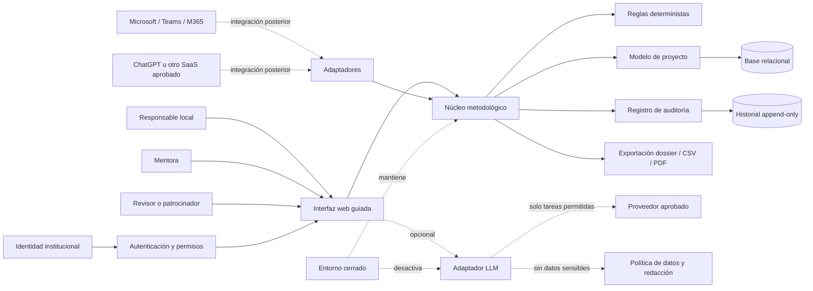

# INFORME A — DISEÑO INDEPENDIENTE DESDE CERO

## 0. Lectura ejecutiva

**Veredicto:** el problema es real, pero la solución no debería empezar como un chatbot de mejora continua.

La necesidad principal parece ser un **sistema de conducción metodológica y trazabilidad**, no una generación automática de ideas. La IA puede ayudar a resumir, reformular, detectar inconsistencias y preparar reuniones, pero no debería decidir:

- cuál es el problema real;
- qué causa está demostrada;
- qué cambio debe implantarse;
- si una evidencia es suficiente;
- si existe autorización para actuar.

La propuesta más prudente es:

> **Núcleo metodológico determinista, interfaz guiada, registro de evidencias y decisiones, mentoría humana y una capa de IA opcional, sustituible y desactivable.**

La iniciativa debería abandonarse o pivotar si no demuestra que los profesionales hacen mejores pasos por sí mismos con menos dependencia de la mentora. Una aplicación que solo produce documentos elegantes sería un fracaso, aunque técnicamente funcione.

---

## 1. Base de la auditoría y clasificación de afirmaciones

### Datos del encargo

- Profesionales sanitarios españoles con poca formación formal en mejora continua.
- Necesitan liderar proyectos reales con autonomía creciente.
- Hospitales heterogéneos.
- Algunos tienen Microsoft 365 Copilot Chat/Teams, otros ChatGPT y otros no pueden usar SaaS externo.
- Datos piloto agregados o sintéticos.
- Recursos limitados y baja tolerancia a costes recurrentes.
- El usuario final no debe necesitar ChatGPT personal, Codex, Git, Markdown ni APIs.

### Hipótesis que deben validarse

- La principal barrera es metodológica y de razonamiento, no solo falta de una herramienta.
- Una secuencia visible de “qué hacemos ahora y por qué” reducirá soluciones prematuras.
- Separar hechos, hipótesis, evidencias y supuestos mejorará el rigor.
- La mentora puede pasar de ejecutar a revisar y desbloquear.
- Los usuarios tolerarán registrar decisiones si el beneficio es inmediato.
- El uso opcional de IA aumentará productividad sin disminuir el pensamiento crítico.

### Opiniones de diseño

Las recomendaciones arquitectónicas y los umbrales de esta auditoría son propuestas iniciales, no resultados demostrados.

---

# 2. Crítica objetiva de la necesidad

## 2.1 La necesidad es plausible, pero está formulada demasiado ampliamente

El problema combina al menos cinco necesidades distintas:

1. Aprendizaje metodológico.
2. Conducción de proyectos reales.
3. Coordinación entre responsable local y mentora.
4. Gestión de reuniones y decisiones.
5. Memoria institucional y trazabilidad.

Intentar resolverlas todas con una única experiencia puede producir una aplicación pesada, llena de formularios y pasos artificiales.

La pregunta crítica es:

> ¿Se necesita software o se necesita primero un modelo operativo claro para que una persona pueda trabajar con autonomía?

Si no existen tiempo protegido, autoridad local, patrocinio y capacidad de probar cambios, ninguna aplicación creará mejora continua. Solo registrará frustración con más precisión.

## 2.2 ¿Necesita IA?

### No para el núcleo del MVP

El flujo básico puede funcionar sin IA:

- plantillas guiadas;
- reglas de avance;
- clasificación manual de afirmaciones;
- historial de decisiones;
- preparación de reuniones;
- registro de pruebas;
- métricas básicas;
- exportación.

De hecho, empezar sin IA tiene ventajas:

- menor riesgo de confidencialidad;
- menor coste;
- comportamiento explicable;
- funcionamiento en entornos cerrados;
- menor dependencia de proveedores;
- mejor evaluación de si la metodología aporta valor por sí misma.

### Sí puede ser útil en tareas acotadas

La IA puede aportar valor como asistente de transformación:

- convertir notas desordenadas en borradores separados por tipo;
- resumir una reunión;
- detectar que una afirmación no tiene evidencia enlazada;
- proponer preguntas de aclaración;
- comparar una hipótesis con observaciones existentes;
- preparar una agenda;
- convertir acuerdos en acciones verificables;
- señalar contradicciones entre decisiones y resultados.

Pero debe operar bajo esta regla:

> La IA puede sugerir, estructurar y señalar. La persona debe aceptar, corregir, rechazar y autorizar.

## 2.3 Alternativas no IA

Antes de construir IA deberían probarse:

1. **Kit metodológico digital sencillo**
   - formularios guiados;
   - fichas de observación;
   - árbol de causas;
   - plantilla de experimento;
   - registro de decisiones.

2. **Aplicación local sin IA**
   - trazabilidad;
   - roles;
   - flujo de trabajo;
   - métricas de rigor y autonomía.

3. **Programa de mentoría estructurada**
   - reuniones breves;
   - guías de conversación;
   - revisión de artefactos;
   - rúbrica de autonomía.

4. **Documentación interactiva**
   - un recorrido por etapas con ejemplos y preguntas;
   - exportación de un dossier de proyecto.

La comparación debe hacerse contra estas alternativas. La IA no merece un lugar por ser moderna; debe demostrar mejora en tiempo, autonomía o calidad.

---

# 3. Diseño funcional UX desde cero

## 3.1 Principios de diseño

### 1. Mostrar siempre el siguiente paso

Cada pantalla debe responder:

- ¿Dónde estamos?
- ¿Qué estamos intentando aprender?
- ¿Qué hacemos ahora?
- ¿Por qué este paso es necesario?
- ¿Qué evidencia permite avanzar?
- ¿Quién debe revisar o autorizar?

### 2. Separar explícitamente tipos de conocimiento

Toda entrada debe poder clasificarse como:

- **Hecho:** algo observado o medido.
- **Hipótesis:** explicación todavía no demostrada.
- **Evidencia:** fuente que respalda o contradice algo.
- **Supuesto:** condición aceptada provisionalmente.
- **Decisión:** elección adoptada.
- **Acción:** tarea asignada.
- **Aprendizaje:** qué cambió después de actuar.

No basta con cambiar colores. La aplicación debe impedir o advertir cuando el usuario intente usar una hipótesis como si fuera un hecho.

### 3. Evitar el camino lineal rígido

El proyecto debe tener etapas recomendadas, pero permitir volver atrás:

```text
Problema
  ↓
Observaciones
  ↓
Hipótesis
  ↓
Evidencia y causas
  ↓
Medición
  ↓
Prueba de cambio
  ↓
Evaluación
  ↓
Adopción o descarte
  ↓
Sostenimiento
```

Cada etapa puede reabrirse. El sistema debe conservar qué cambió y por qué.

### 4. La trazabilidad debe ser útil, no burocrática

Cada decisión importante debería registrar:

- quién;
- cuándo;
- qué se decidió;
- sobre qué evidencia;
- qué alternativas se descartaron;
- quién autorizó;
- cuándo se revisará;
- qué ocurrió después.

No se debe exigir este nivel de detalle para cada nota informal.

---

## 3.2 Estructura de la experiencia

### A. Panel inicial

Muestra:

- proyectos activos;
- siguiente paso recomendado;
- bloqueos;
- decisiones pendientes;
- reuniones próximas;
- acciones vencidas;
- nivel de autonomía aproximado;
- peticiones de la mentora.

No debe ser un panel de indicadores decorativo. Debe ayudar a decidir qué hacer hoy.

### B. Espacio de proyecto

Incluye:

- objetivo;
- alcance;
- responsable local;
- mentora;
- participantes;
- estado;
- decisiones abiertas;
- evidencias;
- experimentos;
- aprendizaje acumulado;
- historial.

El proyecto debe poder representarse como una red de elementos relacionados, no solo como una carpeta de documentos.

### C. Captura de observación

Formulario breve:

1. ¿Qué observaste?
2. ¿Cuándo y dónde?
3. ¿Cómo lo sabes?
4. ¿Qué parte es interpretación?
5. ¿Qué todavía no sabes?
6. ¿Qué decisión podría verse afectada?

Resultado:

```text
Hecho observado:
“Durante cinco turnos, 7 de 12 solicitudes esperaron más de 20 minutos.”

Interpretación:
“Puede existir una cola en la validación.”

Supuesto:
“La disponibilidad del profesional validador fue comparable en los cinco turnos.”

Pregunta siguiente:
“¿La espera se concentra en una franja o persona concreta?”
```

### D. Estudio de causas

No debería generar automáticamente un “diagrama de Ishikawa final”.

Debe ayudar a:

- formular causas posibles;
- asociarlas a observaciones;
- etiquetarlas como confirmadas, refutadas o pendientes;
- identificar qué dato falta;
- evitar que la primera explicación se convierta en la explicación oficial.

### E. Medición

La herramienta debe exigir distinguir:

- medida de resultado;
- medida de proceso;
- medida de equilibrio;
- línea base;
- periodo;
- población o muestra;
- limitaciones.

No debe prometer inferencia clínica ni estadística avanzada en el MVP.

### F. Reuniones

Antes:

- objetivo;
- decisiones necesarias;
- evidencias que deben revisarse;
- participantes necesarios;
- límites de autoridad.

Durante:

- hechos nuevos;
- desacuerdos;
- decisiones;
- acciones;
- autorizaciones;
- preguntas abiertas.

Después:

- acta editable;
- acciones asignadas;
- decisiones enlazadas;
- cambios de hipótesis;
- próxima revisión.

### G. Diseño de pruebas

La ficha mínima:

- cambio que se probará;
- predicción;
- responsable;
- alcance;
- fecha de inicio y fin;
- medida;
- criterio de detener;
- riesgos;
- autorización;
- resultado;
- decisión posterior.

La aplicación debe favorecer pruebas pequeñas y reversibles, no grandes despliegues prematuros.

### H. Adopción y sostenimiento

Antes de marcar un cambio como adoptado:

- ¿qué evidencia lo respalda?
- ¿qué riesgo tiene?
- ¿quién autoriza?
- ¿cómo se formará al equipo?
- ¿qué indicador vigilará la deriva?
- ¿qué ocurrirá si el resultado empeora?

---

## 3.3 Ejemplo de flujo cotidiano

### Martes, 08:30 — responsable local

El responsable observa una demora en una solicitud.

La aplicación pregunta:

> “¿Has observado esto directamente o lo estás interpretando?”

Registra el hecho sin permitir que se convierta todavía en causa.

### Martes, 12:00 — nueva evidencia

Añade tres observaciones más. El sistema detecta que todas provienen de un único turno y muestra:

> “La evidencia actual puede no representar otros turnos. ¿Quieres ampliar la observación o registrar este límite?”

### Miércoles — revisión con mentora

La mentora no reescribe el proyecto. Revisa:

- qué está demostrado;
- qué se está suponiendo;
- qué dato falta;
- qué decisión puede tomarse sin más información.

Aprueba una observación adicional y rechaza una solución propuesta porque todavía no existe una causa contrastada.

### Viernes — reunión

El sistema genera una agenda basada en:

- hipótesis pendientes;
- decisiones bloqueadas;
- acciones vencidas;
- datos recién incorporados.

Después de la reunión se registran dos acciones y una decisión provisional.

### Semana siguiente — prueba

El equipo prueba un cambio en un ámbito pequeño. La herramienta compara predicción y resultado, pero no decide automáticamente si adoptar.

El responsable propone descartar el cambio. La mentora valida que la decisión está sustentada.

---

# 4. Arquitectura propuesta

## 4.1 Principio arquitectónico

La arquitectura debería ser **modular, portable y degradable**:

- funciona sin IA;
- funciona sin integración externa;
- funciona en un entorno cerrado;
- puede añadir un proveedor de IA después;
- no obliga a migrar los datos si se cambia de proveedor.

## 4.2 Diagrama conceptual



## 4.3 Qué debe ser determinista

El núcleo no debería depender de un LLM para:

- estados del proyecto;
- permisos;
- autorizaciones;
- fechas;
- responsables;
- relaciones entre artefactos;
- cálculos de medidas;
- validación de campos obligatorios;
- control de versiones;
- historial;
- exportaciones;
- criterios de avance;
- avisos de datos incompletos;
- separación entre tipos de conocimiento.

Las reglas deben poder explicarse:

> “No puedes marcar esta hipótesis como confirmada porque no tiene evidencia enlazada y requiere revisión humana.”

## 4.4 Qué puede hacer un LLM

Solo mediante un adaptador sustituible y con salida revisable:

- resumir;
- proponer preguntas;
- clasificar borradores;
- detectar contradicciones;
- convertir notas en una agenda;
- sugerir estructura;
- redactar alternativas.

El LLM no debe:

- publicar decisiones automáticamente;
- cambiar estados;
- aprobar pruebas;
- enviar datos a un proveedor sin consentimiento;
- inventar fuentes;
- rellenar mediciones;
- afirmar cumplimiento normativo;
- reemplazar a la mentora.

## 4.5 Qué corresponde al humano

Siempre deben ser humanas:

- definición final del problema;
- validación de hechos;
- aceptación de hipótesis;
- selección de pruebas;
- autorización;
- interpretación del resultado;
- decisión de adopción;
- evaluación de riesgos;
- resolución de desacuerdos.

## 4.6 Almacenamiento

Para el MVP:

- base de datos relacional;
- modelo explícito de proyectos, usuarios, artefactos, decisiones, acciones, reuniones, mediciones y experimentos;
- tabla de auditoría append-only;
- exportación completa del proyecto;
- copias de seguridad dependientes del entorno de despliegue.

No recomiendo empezar con event sourcing completo. Un registro de auditoría bien diseñado es suficiente para el piloto.

Cada evento de auditoría debería incluir:

- actor;
- timestamp;
- organización y proyecto;
- acción;
- objeto afectado;
- versión anterior y nueva, cuando proceda;
- motivo o comentario;
- origen: humano, regla o IA;
- proveedor de IA, si aplica.

## 4.7 Identidad y permisos

Modelo mínimo:

- **Organización**
- **Espacio de trabajo**
- **Proyecto**
- **Usuario**
- **Rol por proyecto**

Roles iniciales:

- responsable local;
- mentora;
- colaborador;
- revisor/patrocinador;
- observador;
- administrador técnico.

Recomendaciones:

- no construir autenticación propia para producción;
- usar el mecanismo de identidad aprobado por cada institución;
- mantener permisos a nivel de proyecto;
- evitar compartir datos entre hospitales por defecto;
- registrar cambios de permisos;
- aplicar mínimo privilegio;
- permitir revocación inmediata.

Para el piloto sintético puede existir un modo aislado de demostración, pero no debe convertirse en el modelo de producción.

## 4.8 Organizaciones y multitenencia

La multitenencia completa aumenta riesgo y complejidad.

Recomendación inicial:

- **despliegue single-tenant por institución o entorno** cuando sea posible;
- modelo de organización desde el inicio;
- ninguna consulta debe poder cruzar organizaciones;
- exportación y eliminación por organización;
- compartir entre hospitales solo como decisión posterior.

## 4.9 Microsoft, ChatGPT y entornos cerrados

### Microsoft 365 / Teams

No asumiría capacidades concretas de licenciamiento, agentes o extensiones. En el MVP:

- exportar agendas y actas;
- copiar enlaces;
- importar datos estructurados de forma controlada;
- evitar dependencia de Copilot Studio;
- no requerir que Teams sea la interfaz principal.

### ChatGPT u otro SaaS

No convertirlo en requisito del usuario final. Si se habilita:

- debe existir un adaptador;
- el usuario debe saber qué datos salen;
- debe poder desactivarse;
- no debe ser el sistema de registro;
- las respuestas deben guardarse como borradores, no como autoridad.

### Entornos cerrados

El núcleo debe funcionar sin llamadas externas. En ese modo:

- IA desactivada;
- sin servicios de terceros;
- exportación local;
- administración institucional;
- datos sintéticos o aprobados.

---

# 5. Alternativas arquitectónicas

| Alternativa | Descripción | Ventajas | Desventajas | Dependencia | Fricción | Coste relativo | Riesgo |
|---|---|---|---|---|---|---|---|
| **A. Sin IA, aplicación local** | Web app con reglas, trazabilidad y exportación | Privacidad, explicabilidad, bajo coste operativo, funciona cerrada | Menos automatización; requiere buen diseño metodológico | Baja | Baja-media | Bajo | Bajo-medio |
| **B. Microsoft-first** | Construida alrededor del ecosistema Microsoft disponible | Posible integración con identidad y colaboración existente | Depende de licencias, configuración, administradores y capacidades no uniformes | Alta | Media-alta | Medio | Medio-alto |
| **C. ChatGPT-first** | La conversación con IA es el centro y el proyecto se registra después | Prototipado rápido; buena interacción conversacional | Dependencia de SaaS, trazabilidad débil, riesgo de datos, resultados inconsistentes | Muy alta | Baja al principio, alta después | Medio | Alto |
| **D. Núcleo portable + IA opcional** | Aplicación independiente con adaptadores de identidad, exportación e IA | Compatible con hospitales heterogéneos; permite desactivar IA; evita bloqueo de proveedor | Requiere diseñar bien las interfaces; algo más de trabajo inicial | Media-baja | Media | Medio | Medio |

## Recomendación

Elegir **D como arquitectura objetivo**, pero implementar el MVP como **A con un punto de extensión para D**.

Es decir:

- núcleo sin IA;
- adaptador de IA diseñado, pero no necesariamente conectado;
- exportación interoperable;
- identidad preparada para integración institucional;
- ninguna dependencia de Microsoft o ChatGPT para el flujo básico.

La alternativa C debe rechazarse para el MVP. Optimiza la demostración, no la autonomía ni la trazabilidad.

---

# 6. MVP y secuencia de 4–6 semanas

## Alcance funcional del MVP

Debe incluir solamente:

1. creación de proyecto;
2. responsables y mentora;
3. guía de siguiente paso;
4. registro de hechos, hipótesis, evidencias y supuestos;
5. decisiones y acciones;
6. reuniones;
7. prueba de cambio;
8. medidas básicas;
9. historial de auditoría;
10. exportación del dossier;
11. modo sin IA;
12. datos sintéticos o agregados.

No incluiría todavía una integración profunda con proveedores externos.

## Semana 1 — Comprender y recortar

- seleccionar 2–3 proyectos piloto;
- observar cómo trabajan hoy;
- acordar vocabulario mínimo;
- definir la rúbrica de autonomía y rigor;
- prototipar el flujo principal;
- registrar el tiempo actual y los puntos de bloqueo.

**Salida:** flujo validado y alcance congelado.

## Semana 2 — Núcleo del proyecto

- proyectos;
- roles;
- artefactos;
- estados;
- decisiones;
- acciones;
- auditoría;
- exportación inicial.

**Salida:** una persona puede registrar un proyecto completo sin IA.

## Semana 3 — Método guiado

- observaciones;
- hechos frente a interpretaciones;
- hipótesis;
- evidencias;
- preguntas de causa;
- criterios de avance;
- avisos de información incompleta.

**Salida:** el sistema dificulta convertir una intuición en una conclusión.

## Semana 4 — Reuniones y pruebas

- agenda;
- acta;
- acciones;
- autorizaciones;
- diseño de experimentos;
- mediciones;
- resultado y aprendizaje.

**Salida:** un proyecto puede completar una prueba pequeña y documentar su decisión.

## Semana 5 — Piloto realista

- 2–3 equipos;
- sesiones observadas;
- revisión con mentoras;
- medición de fricción;
- defectos de flujo;
- prueba en modo cerrado;
- exportación y recuperación.

**Salida:** evidencia de uso real, no solo una demo.

## Semana 6 — Decisión

Elegir una de tres opciones:

- continuar con mejoras concretas;
- pivotar hacia herramienta metodológica sin IA;
- abandonar el producto y conservar solo plantillas, formación o proceso de mentoría.

---

# 7. Métricas y umbrales

Los siguientes valores son **hipótesis de pilotaje**, no garantías.

## 7.1 Autonomía

### Métricas

- porcentaje de siguientes pasos completados sin intervención de la mentora;
- porcentaje de decisiones que el responsable prepara antes de la revisión;
- número de “rescates” de la mentora por proyecto;
- capacidad de explicar por qué se realiza el siguiente paso.

### Señales positivas

- al menos 60 % de las acciones metodológicas se completan sin que la mentora las ejecute;
- reducción progresiva de rescates entre el primer y segundo proyecto;
- el responsable puede distinguir hecho, hipótesis y supuesto durante una revisión.

### Pivotar si

- menos del 40 % de los siguientes pasos se completan autónomamente tras dos ciclos;
- la mentora sigue haciendo el trabajo central;
- los usuarios solo rellenan campos para obtener aprobación.

## 7.2 Rigor

### Métricas

- porcentaje de afirmaciones con tipo correctamente asignado;
- porcentaje de decisiones enlazadas a evidencia;
- hipótesis descartadas o modificadas, no solo confirmadas;
- experimentos con línea base y criterio de evaluación;
- contradicciones detectadas y resueltas.

### Señales positivas

- al menos 80 % de las decisiones relevantes tienen evidencia o supuesto explícito;
- disminuyen las soluciones propuestas antes de observar;
- existen decisiones de “no hacer” justificadas.

### Pivotar si

- el 30 % o más de los proyectos saltan directamente a soluciones;
- el sistema produce principalmente actas y planes sin aprendizaje;
- los usuarios marcan todo como “hecho” sin evidencia.

## 7.3 Fricción

### Métricas

- tiempo hasta registrar la primera observación útil;
- tiempo para preparar una reunión;
- tiempo para documentar una prueba;
- abandono por pantalla;
- acciones duplicadas;
- solicitudes de ayuda.

### Umbrales iniciales

- primera observación útil en menos de 10 minutos;
- captura rutinaria de una observación en menos de 3 minutos;
- preparación de una reunión en menos de 15 minutos;
- abandono inferior al 25 %;
- ningún paso crítico requiere conocimientos técnicos.

### Abandonar o rediseñar si

- la captura rutinaria supera 10 minutos;
- más de un tercio de usuarios necesita ayuda para completar el flujo básico;
- los usuarios prefieren documentos externos porque la aplicación ralentiza el trabajo.

## 7.4 Seguridad y confianza

Cualquier incidente de exposición de datos reales, acceso indebido o envío no autorizado a un proveedor externo debe detener el piloto hasta resolverlo. No debe compensarse con “mejoras de UX”.

---

# 8. Diez riesgos prioritarios y mitigaciones

| Nº | Riesgo | Mitigación |
|---:|---|---|
| 1 | Soluciones prematuras disfrazadas de mejora | Puertas metodológicas, clasificación de afirmaciones y revisión de evidencia |
| 2 | IA que inventa, resume mal o da falsa seguridad | IA solo como borrador; aceptación humana; trazabilidad de origen; sin publicación automática |
| 3 | Introducción accidental de datos identificables | Datos sintéticos por defecto, controles de entrada, modo sin IA, políticas institucionales |
| 4 | La mentora se convierte en cuello de botella | Revisión por excepciones, preguntas guiadas y métricas de rescate |
| 5 | Burocracia metodológica | Formularios progresivos, campos mínimos y valor inmediato después de cada entrada |
| 6 | “Teatro de mejora” | Medir decisiones, experimentos y aprendizajes, no solo número de registros |
| 7 | Hospitales incompatibles entre sí | Núcleo portable, adaptadores opcionales y modo cerrado |
| 8 | Dependencia de licencias o proveedores | Exportación completa, IA sustituible y flujo básico sin SaaS |
| 9 | Ambigüedad de autoridad | Roles explícitos, autorizaciones registradas y límites visibles |
| 10 | Uso clínico o regulatorio indebido | Declarar el alcance: mejora operativa; no diagnóstico, tratamiento ni garantía legal; revisión institucional |

---

# 9. Diez preguntas no resueltas

1. ¿Quién tiene autoridad real para aprobar una prueba de cambio?
2. ¿Cuánto tiempo protegido puede dedicar el responsable local?
3. ¿La mentora revisará todos los proyectos o solo los bloqueados?
4. ¿Cuál es el tamaño mínimo de un proyecto que merece entrar en la herramienta?
5. ¿Qué significa “autonomía” para la organización: ejecutar, decidir, medir o sostener?
6. ¿Qué tipos de datos estarán permitidos en cada hospital?
7. ¿Quién administra identidades, permisos, copias y eliminación?
8. ¿La aplicación debe instalarse dentro del hospital o puede alojarse en infraestructura aprobada?
9. ¿Qué nivel de exportación necesita cada organización?
10. ¿Qué evidencia justificaría pagar por IA después del MVP?

Estas preguntas no deben resolverse inventando funcionalidades. Deben responderse con pilotos, responsables concretos y criterios de decisión.

---

# 10. Qué no construir aún

No construiría en el MVP:

- integración profunda con Teams;
- agentes autónomos;
- integración obligatoria con Copilot o ChatGPT;
- datos de pacientes identificables;
- historia clínica o decisión clínica;
- recomendaciones terapéuticas;
- análisis estadístico avanzado;
- predicción de resultados clínicos;
- repositorio federado entre hospitales;
- marketplace de metodologías;
- aplicación móvil nativa;
- chat conversacional como interfaz principal;
- autenticación propia para producción;
- motor de causas “inteligente” que declare verdades;
- sistema de certificación de competencias;
- panel ejecutivo de cientos de indicadores;
- automatizaciones que cambien estados o autoricen acciones;
- promesas de cumplimiento normativo.

---

# 11. Recomendación final

Construiría primero una **herramienta de pensamiento disciplinado**, no una herramienta de generación de contenido.

El primer producto debe demostrar tres cosas:

1. El profesional local toma mejores decisiones sin que la mentora haga el trabajo.
2. Las decisiones importantes quedan conectadas con observaciones y evidencia.
3. El sistema reduce, en lugar de aumentar, la carga de coordinación.

Solo si esas tres condiciones se cumplen introduciría IA, empezando por tareas de bajo riesgo:

- resumir;
- preguntar;
- ordenar;
- señalar ausencias;
- preparar borradores.

La decisión arquitectónica más importante es esta:

> **La IA debe ser un accesorio reemplazable del núcleo metodológico, nunca el lugar donde viven la verdad, la autorización o la memoria institucional.**

## Key Learnings:

1. El problema requiere primero estructura metodológica y trazabilidad; la IA no es condición necesaria para el MVP.
2. La autonomía debe medirse por decisiones y acciones realizadas por el responsable local, no por documentos generados.
3. Un núcleo determinista y portable permite trabajar en hospitales con capacidades tecnológicas muy diferentes.
4. El mayor riesgo no es que la IA sea poco brillante, sino que haga parecer rigurosa una decisión mal fundamentada.
5. El piloto debe poder concluir honestamente que no merece la pena construir el producto.