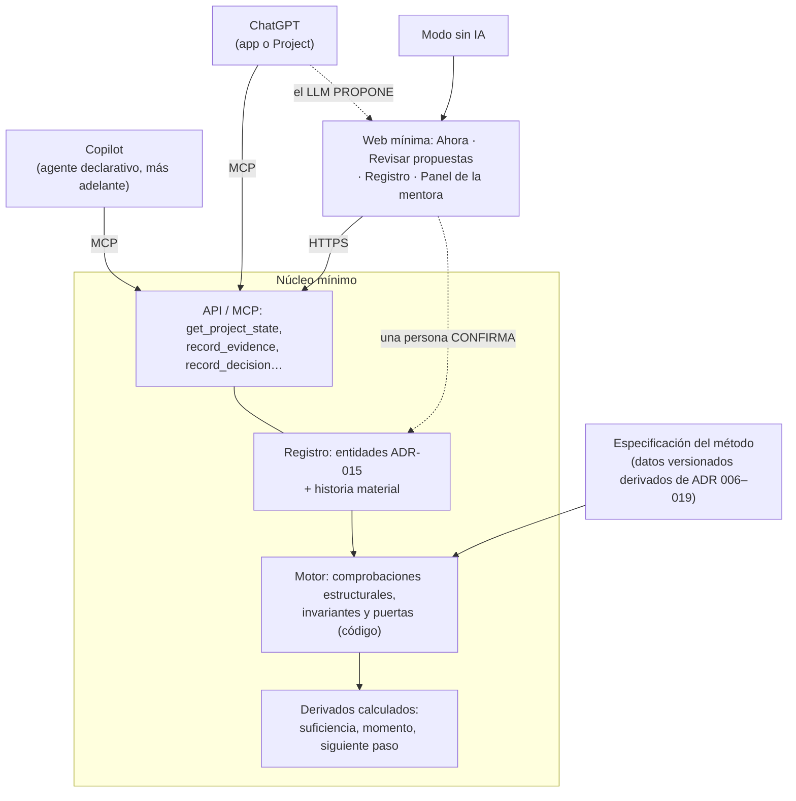
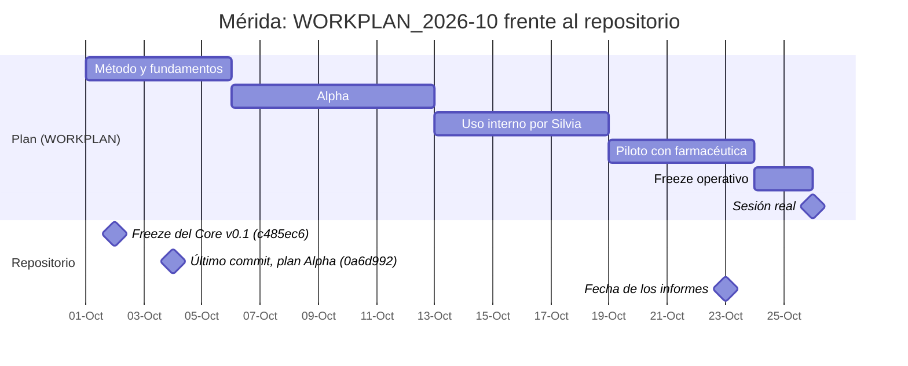

# Informes A y B · CoraLEAN

*Diseño independiente desde cero y auditoría adversarial de CoraLEAN Core v0.1 · 23 de octubre de 2026*

Este archivo reúne, **completos y sin resumir**, los dos informes. Al principio se añade un **resumen comparado** como complemento para orientarse.

## Índice

- [Resumen comparado (complemento de lectura)](#resumen-comparado-complemento-de-lectura)
  - [Los dos informes en una frase](#los-dos-informes-en-una-frase)
  - [Veredicto](#veredicto)
  - [Tesis principales](#tesis-principales)
  - [Convergencias independientes entre A y CoraLEAN](#convergencias-independientes-entre-a-y-coralean)
  - [Dónde gana cada uno](#dónde-gana-cada-uno)
  - [Lo urgente antes del 26 de octubre](#lo-urgente-antes-del-26-de-octubre)
  - [Mapa de decisiones sobre los ADR (según Informe B §4.2–4.5)](#mapa-de-decisiones-sobre-los-adr-según-informe-b-4245)
  - [Arquitectura recomendada (C), en diagrama](#arquitectura-recomendada-c-en-diagrama)
  - [Calendario del piloto: lo previsto frente a lo que muestra el repositorio](#calendario-del-piloto-lo-previsto-frente-a-lo-que-muestra-el-repositorio)
  - [Leyenda de etiquetas](#leyenda-de-etiquetas)
- [INFORME A — DISEÑO INDEPENDIENTE DESDE CERO](#informe-a--diseño-independiente-desde-cero)
  - [1. Diagnóstico ejecutivo](#1-diagnóstico-ejecutivo)
  - [2. Crítica del problema y oportunidad](#2-crítica-del-problema-y-oportunidad)
  - [3. Propuesta funcional ideal](#3-propuesta-funcional-ideal)
  - [4. Arquitectura propuesta desde cero](#4-arquitectura-propuesta-desde-cero)
  - [5. Comparación de alternativas](#5-comparación-de-alternativas)
  - [6. MVP recomendado](#6-mvp-recomendado)
  - [7. Hoja de ruta](#7-hoja-de-ruta)
  - [8. Riesgos y debilidades (auditoría adversarial)](#8-riesgos-y-debilidades-auditoría-adversarial)
  - [9. Propuestas de mejora y diferenciación](#9-propuestas-de-mejora-y-diferenciación)
  - [10. Conclusión y decisiones prioritarias](#10-conclusión-y-decisiones-prioritarias)
- [INFORME B — AUDITORÍA ADVERSARIAL Y COMPARACIÓN DE ARQUITECTURAS](#informe-b--auditoría-adversarial-y-comparación-de-arquitecturas)
  - [0. Alcance, acceso y convenciones](#0-alcance-acceso-y-convenciones)
  - [1. Diagnóstico ejecutivo](#1-diagnóstico-ejecutivo-1)
  - [2. Auditoría del diseño actual](#2-auditoría-del-diseño-actual)
  - [3. Contraste obligatorio: A frente a B frente a C](#3-contraste-obligatorio-a-frente-a-b-frente-a-c)
  - [4. Rediseño contrafactual](#4-rediseño-contrafactual)
  - [5. Priorización ejecutiva](#5-priorización-ejecutiva)

---

# Resumen comparado (complemento de lectura)

> [!NOTE]
> Este resumen es un **complemento** para orientarse. No sustituye ni modifica el texto de los informes, que se reproduce **íntegro y sin cambios** en las partes A y B de este archivo.

## Los dos informes en una frase

| Informe | Pregunta que responde | Material de partida | Conclusión |
|---|---|---|---|
| **A — Diseño independiente desde cero** | ¿Qué herramienta diseñaríamos para que profesionales sanitarios lideren proyectos de mejora, sin conocer vuestra solución? | Solo el encargo, la literatura (PubMed) y documentación pública de Microsoft y OpenAI | Un **multiplicador de la mentoría**: método determinista, registro tipado como fuente de verdad, IA que solo propone y pregunta, canales sustituibles y validación con un servicio "concierge" antes de programar |
| **B — Auditoría adversarial de CoraLEAN v0.1** | ¿Está bien diseñado CoraLEAN y cómo se compara con A? | Repositorio `b32majus/CoraLEAN`: `main` en `c485ec6` (freeze, 2026-10-02) y rama `work/alpha-runtime-c084-20261004` en `0a6d992` (2026-10-04) | El Core metodológico es en varios puntos **mejor que A**, pero se ejecuta con un runtime que no puede hacerlo cumplir. **La solución híbrida C supera a las dos** |

## Veredicto

- **¿Construiría CoraLEAN tal como está diseñado?** No. Conservaría aproximadamente el 70 % de la semántica del Core y cambiaría el runtime, el mecanismo pedagógico y el plan de validación.
- **La mejor opción es C:** la semántica de CoraLEAN ejecutada sobre un registro mínimo determinista, con ChatGPT, Copilot o la web como superficies intercambiables y un programa de mentoría como modelo de negocio.
- **Lo urgente:** la sesión de Mérida es el **26 de octubre de 2026**. Recomendación: no exponer a la farmacéutica a un runtime sin verificar; que Silvia opere CoraLEAN en modo "mago de Oz".

## Tesis principales

**Informe A**
1. El problema es real, pero la mayoría de los fracasos son organizativos, no metodológicos.
2. La referencia que hay que superar es "plantilla A3 + asistente genérico", no la ausencia de herramientas.
3. La IA hace de secretario estructurador e interlocutor socrático. La metodología es determinista y las decisiones son humanas.
4. La transferencia de capacidad exige frenar deliberadamente la ayuda de la IA ("primero tú").
5. MVP: concierge + aplicación web ligera como sistema de registro. Objetivo: núcleo sin interfaz propia con canales web, Teams, Copilot y ChatGPT.

**Informe B**
1. El Core supera a A en experimentar ≠ adoptar, suficiencia para la decisión, condiciones en dos ejes, condiciones habilitantes y procedencia de las intervenciones.
2. Inversión arquitectónica: reglas pensadas para ejecutarse de forma determinista, ejecutadas por un LLM sobre Markdown.
3. La estrella polar (transferencia de capacidad) es lo que menos mecanismo tiene: solo el modo.
4. La validación es excelente en el papel, pero no se ha ejecutado y está sesgada (Silvia diseña, ejecuta y evalúa).
5. El calendario va retrasado frente a `WORKPLAN_2026-10.md` y Mérida es el 26 de octubre.
6. No hay ninguna mención a Microsoft ni a gobernanza de datos, y el estado en Markdown choca con las restricciones del encargo.

## Convergencias independientes entre A y CoraLEAN

| Tema | Informe A | CoraLEAN v0.1 |
|---|---|---|
| Ciclo central de trabajo | Preparar → Celebrar → Consolidar la reunión | Skills *Preparar reunión* y *Procesar reunión* (ADR-016) |
| Orientación | Pantalla "Ahora": siguiente paso y su porqué | "Siguiente paso + razón" siempre recuperable (ADR-014) y seis momentos (ADR-012) |
| Fuente de verdad | El registro es la verdad; la conversación es efímera | El estado es la verdad; la conversación es la superficie (ADR-015) |
| Papel de la IA | Propone; una persona confirma | Procesar reunión propone y nunca modifica el estado directamente (ADR-016) |
| Falsa precisión | Sin porcentajes; color según la madurez | Sin porcentajes; suficiencia categórica (ADR-006/008) |
| Interfaz MCP | Servidor MCP como adaptador de canales | Operaciones MCP de dominio listadas en `AGENTS.md` |

## Dónde gana cada uno

| CoraLEAN (B) supera a A en… | A supera a CoraLEAN (B) en… |
|---|---|
| Modelo metodológico no lineal con reapertura como evento | Cumplimiento real (determinista) de las reglas |
| Proporcionalidad (condiciones habilitantes, condiciones en dos ejes) | Adopción institucional (Teams, Entra, Copilot, modo sin IA) |
| Procedencia que distingue la intervención humana de la de CoraLEAN | Gobernanza de datos y cuentas |
| Procedencia de la guía (fuente / síntesis / evidencia local) | Mecanismo pedagógico ("primero tú", retirada de ayuda por competencia) |
| Honestidad epistémica (ADR-017 separa capacidad, decisión y supuesto) | Aspectos específicos del PDSA (predicción, datos en el tiempo) |
| Validación más falsable (S1–S14, RT-01…RT-12) | Diseño de la medición y viabilidad del modelo de servicio |

## Lo urgente antes del 26 de octubre

| # | Acción | Coste |
|---|---|---|
| R1 | Sesión operada por Silvia; la farmacéutica no usa directamente un runtime sin verificar | Bajo |
| R2 | Materializar el fixture y ejecutar RT-01 cinco veces (determinismo) y RT-03 midiendo el tiempo de guardado | ½–1 día |
| R3 | Comprobar la cuenta y los datos: plan, entrenamiento desactivado, sin nombres de pacientes | 1 h |
| R4 | Medición basal de la farmacéutica, rúbrica y evaluador independiente | ½ día |
| R13 | Quitar «phase» de `FEEDBACK_PROTOCOL.md` antes de usarlo en el piloto | 2 h |

## Mapa de decisiones sobre los ADR (según Informe B §4.2–4.5)

- **Conservar intactas:** ADR-001, ADR-004, ADR-005, ADR-006, ADR-007, ADR-009, ADR-010, ADR-011, ADR-012, ADR-015 (principios), ADR-016, ADR-019.
- **Simplificar:** ADR-008 y ADR-018 (criterios estructurales frente a criterios de juicio), ADR-012 (un solo foco), ADR-013 (verificación por afirmación solo si se cita), ADR-014 (reabrir las dimensiones), ADR-015 (procedencia automática) y la documentación.
- **Cambiar:** ADR-002 y ADR-017 (estado canónico fuera del LLM), ADR-014 (mecanismo de aprendizaje), ADR-019 y el piloto (validación), y añadir ADR nuevos de gobernanza y de vía Microsoft / sin IA.
- **Eliminar:** el bootstrap autoconfigurado, el modelo "recurso" con GitHub o base de datos gestionados por el usuario, Sites como cockpit, las pruebas RT-04/06/07/08 si se adopta el estado fuera del LLM, y la orquestación multiagente para producir documentación.

## Arquitectura recomendada (C), en diagrama



## Calendario del piloto: lo previsto frente a lo que muestra el repositorio



## Leyenda de etiquetas

| Etiqueta | Informe | Significado |
|---|---|---|
| **[H]** | A | Hecho verificado, con fuente |
| **[Hip]** | A y B | Hipótesis o juicio experto todavía no verificado |
| **[R]** | A | Recomendación |
| **[DEM]** | B | Defecto demostrado: se ve directamente en los documentos |
| **[RIE]** | B | Riesgo hipotético: plausible, pero no observado |
| **[PREF]** | B | Preferencia de diseño: discutible |
| **[FORT]** | B | Fortaleza |

---

# INFORME A — DISEÑO INDEPENDIENTE DESDE CERO

**Cómo leer este informe:** cada afirmación importante lleva una etiqueta.
- **[H]** Hecho verificado, con fuente.
- **[Hip]** Hipótesis o juicio experto todavía no verificado.
- **[R]** Recomendación.

He consultado literatura en PubMed y documentación pública de Microsoft y OpenAI. Las limitaciones de esas fuentes se indican donde corresponde.

---

## 1. Diagnóstico ejecutivo

1. **El problema existe y está documentado, pero el encargo lo describe de forma incompleta.** La literatura confirma que muchos proyectos de mejora aplican mal el método. Sin embargo, las principales causas de fracaso documentadas son organizativas y sociales: tiempo, mandato, datos, implicación del equipo y sostenibilidad. La falta de saber "qué hacer y en qué orden" es solo una parte. Un producto que resuelva únicamente lo metodológico puede quedarse en una mejora pequeña del problema real.

2. **La referencia a superar no es "no tener nada".** Hay dos referencias reales:
   - **(a) Un mentor humano experto.** Es lo que funciona, pero es escaso y caro.
   - **(b) Una plantilla A3 junto con un asistente genérico** (un GPT personalizado o un agente de Copilot con buenas instrucciones). Es casi gratis y estará disponible en meses.

   El producto tiene que demostrar que supera claramente a (b) y que amplía el alcance de (a). Si no lo consigue, no merece la pena construirlo.

3. **La IA no debe ser el facilitador.** Su papel correcto es doble: hacer de **secretario estructurador**, que convierte notas desordenadas en elementos tipados, y de **interlocutor socrático**, que pregunta y no responde. La metodología (fases, comprobaciones, puertas de avance) debe ser **determinista y auditable**. Las decisiones deben ser **siempre humanas y nominales**.

4. **La transferencia de capacidad es lo que diferencia al producto, y también su mayor riesgo.** Hay evidencia experimental de que la IA generativa sin salvaguardas mejora el rendimiento mientras se usa, pero **empeora el aprendizaje** cuando se retira. Si el objetivo es crear autonomía, el diseño debe frenar deliberadamente la ayuda de la IA.

5. **Recomendaciones de arquitectura:**
   - **MVP:** un servicio de mentoría acompañado de una aplicación web ligera que actúe como **sistema de registro**, con un motor metodológico de reglas y un LLM opcional y sustituible.
   - **Arquitectura objetivo:** un **núcleo sin interfaz propia (API + motor + registro)** con varios canales de acceso: web, pestaña de Teams, agente de Copilot y app de ChatGPT, los tres últimos a través de un único servidor MCP. Incluiría un modo sin IA y otro con el modelo de la propia organización.
   - **Lo que no recomiendo:** construir el producto *dentro* de Copilot o de ChatGPT como sistema principal.

6. **Antes de escribir código:** dedicar de 4 a 6 semanas a un piloto "concierge", con un mentor humano que hace de motor y un cuaderno estructurado. Debe compararse explícitamente con la referencia "plantilla + asistente genérico".

---

## 2. Crítica del problema y oportunidad

### 2.1 ¿Es un problema importante y bien definido?

**Es importante.** Lo que muestra la literatura:
- **[H]** En una revisión sistemática de 73 artículos con PDSA, menos del 20 % documentó ciclos iterativos completos. Solo el 15 % usó datos cuantitativos mensuales o más frecuentes para decidir el siguiente ciclo (Taylor et al., *BMJ Qual Saf* 2014, [DOI](https://doi.org/10.1136/bmjqs-2013-001862)).
- **[H]** En 120 proyectos PDSA publicados en 2015–2016, el 98 % declaró haber mejorado. Pero solo el 27 % tenía un objetivo cuantitativo concreto y lo alcanzó, y solo 3 de 72 (4 %) cumplían los cuatro rasgos metodológicos clave (Knudsen et al., *BMC Health Serv Res* 2019, [DOI](https://doi.org/10.1186/s12913-019-4482-6)).
- **[H]** El PDSA suele tratarse como una herramienta sencilla, cuando en realidad exige competencias, tiempo y apoyo organizativo (Reed & Card, *BMJ Qual Saf* 2016, [DOI](https://doi.org/10.1136/bmjqs-2015-005076)).

Estos datos proceden de proyectos *publicados*. Los no publicados probablemente están peor **[Hip]**.

**Está mal acotado en un punto clave.** La evaluación de los programas de la Health Foundation identificó diez retos principales (Dixon-Woods et al., *BMJ Qual Saf* 2012, [DOI](https://doi.org/10.1136/bmjqs-2011-000760)):
- convencer de que el problema existe;
- convencer de que la solución es la correcta;
- conseguir los datos;
- el exceso de ambición y de "proyectitis";
- la cultura;
- el tribalismo;
- el liderazgo;
- los incentivos;
- la sostenibilidad;
- las consecuencias no deseadas.

**[H]** Solo uno o dos de esos retos son estrictamente de "método".

**[Hip]** El encargo atribuye a la falta de saber hacer un fracaso que en buena parte se debe a falta de *poder hacer*: tiempo protegido, patrocinio y acceso a datos.

**[R]** Redefinir el problema así: *"Profesionales con un problema real y algo de margen de acción no consiguen convertirlo en un aprendizaje validado y sostenido. Les faltan, en este orden: estructura de razonamiento, acompañamiento oportuno, una forma de mover al equipo y una forma de demostrar el resultado."* Las dos últimas carencias deben estar en el alcance del producto, no fuera.

### 2.2 ¿Hace falta una herramienta nueva?

**[H]** La mentoría en mejora de la calidad tiene evidencia favorable, aunque de certeza baja o muy baja:
- Una revisión sistemática de 23 ensayos aleatorizados por conglomerados encontró un efecto probablemente beneficioso sobre los indicadores de proceso (Ballengee et al., *J Gen Intern Med* 2022, [DOI](https://doi.org/10.1007/s11606-021-07217-2)).
- En un ensayo del sistema sanitario de veteranos de EE. UU. (VA), los centros con mentoría hicieron proyectos más complejos y rigurosos y desarrollaron más capacidades que los que solo tenían el kit de herramientas. Al cabo de 18 meses, solo los centros con mentoría seguían adaptando y extendiendo sus proyectos (Penney et al., *BMC Health Serv Res* 2021, [DOI](https://doi.org/10.1186/s12913-021-06850-1)).

**Consecuencia:** *un kit de herramientas sin acompañamiento rinde claramente menos que el kit con acompañamiento*. Esto apoya la necesidad de algo más que plantillas. No demuestra que el software pueda sustituir a la mentoría.

| Alternativa sin producto nuevo | Qué resuelve | Qué no resuelve |
|---|---|---|
| Formación (cursos de Lean o de mejora) | Conocimiento declarativo | La aplicación en el momento en que se necesita; el olvido; la falta de oportunidad para practicar |
| Facilitación humana | Casi todo | No escala; es cara; depende de la persona |
| Herramientas de gestión de proyectos de mejora (Life QI, KaiNexus u otras) **[Hip: verificar sus funciones actuales]** | Registro, cartera de proyectos, gráficos | La guía pedagógica sobre *qué pensar ahora* |
| Plantilla + asistente genérico de IA | Borradores y explicaciones | Estado del proyecto, rigor exigible, trazabilidad y aprendizaje; además hace el trabajo por el usuario |

**[R]** La herramienta tiene sentido como **multiplicador de la mentoría**: lograr que un mentor atienda bien a 5–10 veces más proyectos y que el profesional piense mejor entre sesión y sesión. No tiene sentido como sustituto del mentor. Esto cambia el producto, el comprador y el precio.

### 2.3 Dónde aporta valor la IA y dónde introduce riesgo

| Aporta valor diferencial | Introduce riesgo o complejidad innecesaria |
|---|---|
| Convertir notas o transcripciones de reuniones en elementos tipados *propuestos* (hecho, supuesto, decisión, acción) | Generar causas raíz o soluciones: suplanta el pensamiento del equipo y produce una falsa sensación de rigor |
| Detectar patrones erróneos en el lenguaje natural (por ejemplo, una solución escondida en el enunciado del problema, o culpabilización) | Decidir si se avanza de fase: eso debe hacerlo una regla con la decisión explícita de una persona |
| Hacer preguntas socráticas adaptadas al contexto | Calcular estadísticas o evaluar resultados: lo hace mejor una regla determinista |
| Reformular, resumir y preparar borradores de agendas | Ser la memoria del proyecto: la memoria debe ser el registro, no la conversación |
| Explicar conceptos con ejemplos del propio servicio | Usarse como interfaz principal en forma de chat libre: genera dependencia, dispersión y documentación inconsistente |

**[H]** En un experimento de campo con cerca de mil estudiantes, el acceso a un asistente tipo ChatGPT sin salvaguardas mejoró el rendimiento en la práctica. Pero, al retirarlo, esos alumnos obtuvieron un 17 % peor nota que el grupo sin acceso. Un tutor con salvaguardas pedagógicas mitigó en gran parte ese efecto (Bastani et al., *PNAS* 2025, [resumen Wharton](https://knowledge.wharton.upenn.edu/article/without-guardrails-generative-ai-can-harm-education), [SSRN](https://papers.ssrn.com/abstract=4895486)).
- **Límite de esta evidencia:** se trata de matemáticas en secundaria, no de profesionales adultos en mejora de procesos. Aun así, el mecanismo es directamente pertinente: delegar el pensamiento reduce el aprendizaje.

### 2.4 Hipótesis del planteamiento que cuestiono

1. *"El cuello de botella es saber qué hacer."* Puede que lo sea el tiempo, el patrocinio o el acceso a los datos. **Debe medirse.**
2. *"El proyecto es la unidad adecuada."* Muchas mejoras no deberían ser un proyecto: necesitan un "hazlo ya", una ronda de mejora rápida o gestión diaria (reuniones breves de equipo y paneles de mejora). Un producto que convierte todo en un A3 de seis meses genera burocracia.
3. *"Los usuarios registrarán información con regularidad."* La carga de documentación es la causa más probable de abandono. **[Hip]**
4. *"Hay una metodología."* Cada organización tiene su variante (Lean, el Modelo de Mejora del IHI, Seis Sigma o una metodología propia). Si se impone una sola, el producto choca con las unidades de calidad.
5. *"El usuario es una persona."* La mejora es social. El usuario real es **un equipo con un líder, un mentor y un patrocinador**.
6. *"La IA es necesaria."* Esto debe ponerse a prueba con una versión sin IA. Si esa versión aporta el 80 % del valor, cambia la economía del producto.
7. *"Los mentores adoptarán la herramienta."* Los mentores expertos tienen sus propios métodos y pueden verla como una amenaza o como trabajo extra.

---

## 3. Propuesta funcional ideal

### 3.1 Principios de diseño

1. **Primero tú.** En cada paso de razonamiento (enunciar el problema, proponer causas, hacer una predicción), el usuario escribe su respuesta *antes* de ver cualquier sugerencia. La IA critica o completa, pero no empieza ella.
2. **El registro es la verdad.** Todo lo que importa es un elemento tipado con su procedencia. La conversación es efímera.
3. **Rigor proporcional.** Al inicio, un triaje determina si el caso necesita un "hazlo ya", una mejora rápida (de 2 a 4 semanas) o un proyecto completo. La herramienta también puede decir *"esto no necesita un proyecto"*.
4. **Organizado en torno a la reunión y a la semana, no al chat.** El ritmo natural es este: preparar la reunión, celebrarla, consolidar lo tratado y dedicar unos 15 minutos semanales.
5. **Puertas que preparan, no que bloquean.** Las comprobaciones avisan de lo que falta. El usuario puede avanzar justificándolo, y la justificación queda registrada. Bloquear genera abandono; avisar con trazabilidad genera aprendizaje.
6. **La ayuda se retira de forma progresiva y visible.** Cada competencia tiene un nivel de asistencia que baja cuando el usuario demuestra dominio.
7. **Debe ahorrar más trabajo del que añade.** Si registrar una reunión cuesta más de 5 minutos, el diseño ha fallado.

### 3.2 Objetos centrales (el lenguaje del producto)

- **Proyecto.** Tiene una escala (rápida o completa), un equipo, un patrocinador y un mentor.
- **Problema.** Incluye la brecha medible, a quién afecta, dónde y cuándo, y el impacto.
- **Elementos epistémicos:**
  - **Hecho**, siempre con fuente y fecha.
  - **Supuesto.**
  - **Hipótesis causal**, vinculada a hechos que la apoyan o la contradicen.
  - **Pregunta abierta.**
- **Medida:** definición operativa, fuente, frecuencia y línea base.
- **Idea aparcada:** soluciones propuestas antes de tiempo. No se reprimen, se guardan para la fase adecuada.
- **Ciclo de prueba (PDSA):** cambio, **predicción obligatoria**, escala, medida, resultado y aprendizaje.
- **Decisión:** qué se decide, **quién decide (persona y rol)**, alternativas descartadas, evidencias en las que se apoya y fecha.
- **Acción:** responsable, fecha y estado.
- **Autorización:** quién autoriza, qué autoriza y con qué alcance.
- **Sesión:** una reunión, con su preparación, notas originales, elementos consolidados y acuerdos.
- **Aprendizaje:** lo que se transfiere a otros proyectos.

### 3.3 Interfaz y navegación

Hay cuatro vistas y un flujo transversal:

```
┌──────────────────────────────────────────────────────────────────┐
│ [Ahora]  [A3 vivo]  [Registro]  [Equipo]          Proyecto ▾     │
├──────────────────────────────────────────────────────────────────┤
│ AHORA                                                            │
│  Estás en: Entender la situación actual (semana 3)               │
│  ▸ Siguiente paso recomendado: Definir cómo medirás el retraso   │
│    Por qué: tienes 3 hipótesis causales y ningún dato de base.   │
│    [Hacerlo ahora · 10 min]  [Preparar reunión para esto]        │
│  ▸ Te falta (2): línea base · validar supuesto S4 con admisión   │
│  ▸ Pendiente del equipo: 2 acciones vencidas (Ana, Luis)         │
│  ▸ Ideas aparcadas: 4  (se recuperarán en "Diseñar cambios")     │
└──────────────────────────────────────────────────────────────────┘
```

- **Ahora:** una pantalla para alguien que tiene 10 minutos. Muestra el siguiente paso, el porqué, lo que falta y lo que está pendiente.
- **A3 vivo:** el proyecto en una sola página. Cada sección tiene un color según su madurez: vacía, borrador, apoyada en evidencias o validada por el mentor. Se puede imprimir, porque muchas reuniones se celebran con papel o pizarra.
- **Registro:** línea temporal filtrable de hechos, decisiones, acciones y autorizaciones, con su procedencia.
- **Equipo:** roles, compromisos y quién debe aportar qué.
- **Flujo de sesión:** Preparar → Celebrar → Consolidar (véase el apartado 3.4).

El chat existe solo como **panel lateral contextual** ("pregúntame sobre este paso"). No es la pantalla principal.

### 3.4 Recorridos solicitados

**Primer proyecto.**
- Incorporación de unos 10 minutos con un caso de ejemplo, en el que el usuario ve un proyecto bien hecho.
- Triaje con 6 preguntas: ¿se conoce la causa?, ¿la solución es obvia y reversible?, ¿afecta a varios servicios?, ¿hay datos?, ¿quién debe autorizar?, ¿hay un patrocinador?
- Resultado: "hazlo ya", mejora rápida o proyecto completo, con explicación.
- Se piden el patrocinador y el mentor desde el principio. Sin patrocinador, la herramienta lo marca como riesgo; no impide continuar.

**Explicar un problema.**
- El usuario lo cuenta con sus palabras, por texto o por voz.
- La herramienta devuelve un enunciado estructurado que el usuario edita.
- Unos detectores (reglas y LLM) señalan problemas típicos:
  - una solución escondida ("falta un protocolo de...");
  - culpabilización ("enfermería no...");
  - vaguedad ("hay retrasos");
  - ausencia de magnitud.
- Cada señal viene con una pregunta, no con una corrección: *"¿Cuánto es el retraso hoy y cómo lo sabes?"*

**Aprender a investigar sin precipitarse.**
- Las soluciones que aparecen pronto van al **aparcamiento de ideas**, con el mensaje visible *"buena idea, la guardamos para cuando sepamos la causa"*.
- La fase de comprensión propone un **plan de observación en el lugar de trabajo** (qué mirar, a quién preguntar, una hoja de recogida sencilla) y un mapa SIPOC o de proceso **solo si el triaje lo justifica**.
- Una regla impide pasar a "diseñar cambios" sin al menos una medida con línea base y dos hechos verificados que apoyen la hipótesis principal. Se puede saltar con una justificación registrada.

**Preparar una reunión.**
- El usuario elige el objetivo de la reunión: entender, decidir, priorizar, revisar una prueba o comprometer recursos.
- La herramienta genera, a partir del estado del proyecto: agenda con tiempos, preguntas clave, decisiones que se buscan, información que debe traer cada persona y una técnica de facilitación sugerida (por ejemplo, 1-2-4-todos o votación por puntos).
- Exporta un documento de una página para imprimir o compartir en Teams.

**Incorporar las notas.**
- El usuario pega las notas o la transcripción de Teams, o sube una foto de la pizarra.
- La IA **propone** elementos tipados. Cada uno es una tarjeta con las opciones aceptar, editar o descartar, y muestra el fragmento original del que sale.
- Nada entra en el registro sin confirmación humana.
- Las decisiones exigen nombrar a quien decide.
- Antes de enviar texto al modelo de lenguaje, un detector de datos personales avisa si aparecen nombres de pacientes o datos de salud.

**Registrar evidencias y decisiones.** Siempre con procedencia: sesión, persona y documento. Las decisiones enlazan las evidencias en que se basan y las alternativas descartadas.

**Entender qué falta.** Un **análisis determinista de huecos** por fase, por ejemplo: "tienes hipótesis sin evidencias", "una medida sin definición operativa" o "una decisión sin responsable". Siempre explica *por qué importa*.

**Orientación sobre qué hacer ahora.** El motor de reglas prioriza el siguiente paso según la fase, los huecos, las acciones vencidas y la próxima reunión. La IA solo redacta la explicación en lenguaje natural.

**Probar un cambio.**
- La ficha de prueba exige una **predicción escrita antes de empezar** (regla dura), una escala pequeña (una cama, un turno o un día), la medida y el período.
- Un gráfico de evolución recoge la línea base y los datos nuevos, introducidos a mano o desde una hoja de cálculo.

**Evaluar resultados.**
- Las reglas de los gráficos de evolución (desplazamientos, tendencias, rachas) se calculan de forma determinista. Si hay pocos puntos, se advierte explícitamente.
- La comparación entre predicción y resultado es obligatoria.
- La decisión de adoptar, adaptar o abandonar la toman personas con nombre propio.
- La IA solo explica el gráfico en lenguaje llano y plantea preguntas.

**Reanudar tras varias semanas.**
- Un resumen de "dónde lo dejaste" en 5 líneas, construido a partir del registro: fase, última decisión, acciones abiertas, lo que cambió y el siguiente paso.
- Un "test de recuperación" opcional de 3 preguntas, que sirve a la vez como métrica.

**Autonomía progresiva.**
- Un mapa de unas 10 competencias (enunciar problemas, separar hechos de supuestos, definir medidas, preparar reuniones, diseñar pruebas con predicción, interpretar gráficos de evolución, gestionar decisiones, sostener la mejora, entre otras).
- Cuatro niveles de asistencia por competencia:
  - **N1 Mostrar:** ejemplo resuelto.
  - **N2 Guiar:** preguntas y estructura parcial.
  - **N3 Revisar:** el usuario hace el trabajo y la herramienta lo critica.
  - **N4 Autónomo:** la herramienta calla salvo que detecte un error claro.
- Se pasa de nivel según **comportamientos observables en el registro**, por ejemplo tres enunciados de problema sin solución escondida.
- El usuario puede pedir más ayuda; esa petición queda registrada y no penaliza.
- Este marco sigue el modelo de aprendizaje cognitivo en la práctica, con ayuda que se retira progresivamente **[Hip: aplicabilidad a este dominio no verificada]**.

### 3.5 El papel del mentor

El mentor tiene un panel con todos sus proyectos, ordenados por **riesgo metodológico** y por **inactividad**. Desde ahí puede:
- validar secciones del A3;
- comentar elementos concretos;
- decidir el nivel de asistencia de cada persona.

**[Hip]** Con esto, una revisión asíncrona de 15 minutos podría sustituir a una reunión de una hora.

---

## 4. Arquitectura propuesta desde cero

### 4.1 Reparto de responsabilidades

| Determinista (reglas y código) | IA (LLM, siempre como propuesta) | Juicio humano (obligatorio) |
|---|---|---|
| Fases, comprobaciones y huecos; prioridad del siguiente paso | Pasar texto libre a elementos tipados propuestos | Qué problema abordar y con qué alcance |
| Triaje de rigor (árbol de decisión) | Detectar patrones erróneos en lenguaje natural (complementa a las reglas) | Validar si algo es un hecho o un supuesto |
| Puertas: predicción previa a la prueba, responsable de cada decisión | Preguntas socráticas contextuales | Elegir hipótesis y cambios |
| Reglas de gráficos de evolución y cálculos | Borradores de agenda, resumen y explicación | Adoptar, adaptar o abandonar |
| Niveles de asistencia y criterios de progresión | Explicar conceptos con ejemplos del caso | Autorizaciones y recursos |
| Permisos, auditoría y versiones | Reformular para distintos públicos (dirección o equipo) | Validación del mentor |
| Detección de datos personales por patrones | Segunda capa de detección de datos personales (si está permitida) | Decidir qué se comparte fuera del equipo |

**Regla de oro:** el LLM **nunca escribe directamente en el registro** ni cambia la fase. Solo produce propuestas que una persona confirma.

### 4.2 Diagrama

```
                     CANALES (interfaces sustituibles)
 ┌───────────┐ ┌──────────────┐ ┌────────────────┐ ┌──────────────┐
 │ Web (PWA) │ │ Pestaña Teams│ │ Agente Copilot │ │ App ChatGPT  │
 │ principal │ │ (misma web + │ │ (declarativo)  │ │ (workspace)  │
 │           │ │  SSO Entra)  │ │                │ │              │
 └─────┬─────┘ └──────┬───────┘ └───────┬────────┘ └──────┬───────┘
       │ HTTPS/API    │                 └──────┬──────────┘
       │              │                  ┌─────▼──────────┐
       │              │                  │ Servidor MCP   │  (herramientas: leer estado,
       │              │                  │ (adaptador)    │   proponer elementos, siguiente paso)
       │              │                  └─────┬──────────┘
 ┌─────▼──────────────▼────────────────────────▼──────────────────┐
 │                         NÚCLEO (API)                           │
 │  ┌──────────────────┐  ┌────────────────┐  ┌────────────────┐  │
 │  │ Motor            │  │ Registro del   │  │ Pedagogía      │  │
 │  │ metodológico     │  │ proyecto       │  │ (competencias, │  │
 │  │ (reglas          │◄─┤ (eventos solo  │  │ niveles,       │  │
 │  │ versionadas,     │  │ de añadido +   │  │ retirada de    │  │
 │  │ especificación   │  │ vistas)        │  │ ayuda)         │  │
 │  │ del método)      │  └────────────────┘  └────────────────┘  │
 │  └──────────────────┘                                          │
 │  ┌──────────────────┐  ┌────────────────┐  ┌────────────────┐  │
 │  │ Identidad/roles  │  │ Auditoría      │  │ Pasarela de    │  │
 │  │ (OIDC: Entra /   │  │ (quién, qué,   │  │ IA: datos      │  │
 │  │ enlace mágico)   │  │ cuándo, origen)│  │ personales,    │  │
 │  └──────────────────┘  └────────────────┘  │ plantillas     │  │
 │                                            │ versionadas,   │  │
 │                                            │ evaluaciones,  │  │
 │                                            │ registro       │  │
 │                                            └───────┬────────┘  │
 └────────────────────────────────────────────────────┼───────────┘
                                                      │ (opcional, por organización)
                      ┌───────────────────────────────┼────────────────────┐
                      ▼                               ▼                    ▼
              LLM en nube UE              LLM de la propia        SIN IA (modo
              (proveedor gestionado)      organización (Azure     completo con
                                          OpenAI en su entorno     reglas y
                                          o modelo local con API   plantillas)
                                          compatible)
 Persistencia: PostgreSQL (seguridad por fila por organización) + almacenamiento de
 adjuntos + copias de seguridad cifradas. Exportación completa en JSON y PDF/DOCX.
```

### 4.3 Componentes

**Motor metodológico.**
- El método se escribe como **especificación declarativa versionada** (YAML o JSON): fases, comprobaciones, puertas, preguntas, criterios de progresión.
- Lo interpreta un motor de reglas sencillo escrito en código propio. No hace falta un motor de reglas empresarial **[R]**.
- Ventajas: auditable; adaptable a la variante de cada organización sin tocar código; comprobable con proyectos de prueba.
- Es el **activo principal** del producto, junto con el contenido pedagógico.

**El papel y los límites del LLM.**
- Tareas acotadas con salida en formato estructurado y validada contra un esquema.
- Plantillas de instrucciones versionadas, con una **batería de evaluación** (unos 50 casos reales anonimizados) que se ejecuta cada vez que se cambia de modelo o de plantilla.
- Sin memoria propia: el contexto se construye en cada llamada a partir del registro.
- Sin acceso a internet ni a herramientas que escriban.
- Coste estimado **[Hip]**: unos pocos euros por proyecto al mes con modelos de gama media. No es la principal fuente de coste.

**Modelo de estado.**
- **Registro de eventos de solo añadido**, del tipo "elemento propuesto", "elemento confirmado", "decisión tomada", "fase avanzada", "puerta superada con justificación"...
- Sobre él se construyen **vistas** (el A3 vivo, el panel Ahora, el panel del mentor).
- Así se obtienen trazabilidad, versionado y "cómo estaba el proyecto el día X" sin desarrollo adicional.
- No hace falta un framework de *event sourcing*: basta una tabla de eventos en PostgreSQL y vistas materializadas **[R]**.

**Persistencia, versionado y recuperación.**
- Copias de seguridad diarias cifradas, con recuperación a un momento dado.
- **Exportación completa** en JSON (portabilidad) y en PDF/DOCX (para los archivos de calidad y para auditorías de acreditación).
- La especificación del método está versionada: cada proyecto sabe con qué versión se evaluó.

**Trazabilidad y autorizaciones.**
- Cada elemento guarda: autor, procedencia (sesión, documento o propuesta de la IA), quién lo confirmó y cuándo.
- Las **decisiones y autorizaciones** van ligadas a una persona y su rol; no basta con "el equipo".
- Una propuesta de la IA confirmada sin editar queda marcada como tal. También es una señal de aprendizaje: aceptar sin revisar es un mal indicio.

**Usuarios, roles y colaboración.**
- Roles: Líder, Miembro, Mentor (puede pertenecer a otra organización), Patrocinador (decide y autoriza), Observador y Administrador de la organización.
- Colaboración asíncrona con comentarios sobre elementos.
- La edición simultánea en tiempo real queda fuera del MVP.

**Aislamiento entre organizaciones.**
- Cada organización es un inquilino, con seguridad por fila en PostgreSQL.
- Opción de base de datos dedicada para quien lo exija.
- El mentor externo accede mediante una **invitación explícita por proyecto**, con alcance y fecha de caducidad, que queda en el registro de auditoría.

**Seguridad y gobernanza sanitaria.** Lo que sigue tiene el contexto español en mente; **[Hip]** requiere revisión legal.
- Alojamiento en la UE.
- RGPD: evaluación de impacto si entran datos de profesionales; contratos de encargado del tratamiento con el proveedor del LLM, con cláusula de no entrenamiento.
- Esquema Nacional de Seguridad (ENS): probablemente categoría MEDIA para dar servicio a centros públicos. Esto tiene coste de certificación y es una barrera real de venta.
- **Ley de IA de la UE:**
  - El sistema no parece de alto riesgo mientras **no se use para evaluar el desempeño de trabajadores**. Las competencias se registrarían, y si la dirección las usara para evaluar personal podría entrar en el Anexo III, apartado 4 (empleo). **[R]** Las competencias deben ser del profesional, no de la organización. Solo se agregan de forma anónima.
  - La obligación de alfabetización en IA (art. 4) ya es aplicable.
- No es producto sanitario mientras no tenga una finalidad clínica sobre pacientes concretos.

**Microsoft Copilot y Teams.**
- La integración más barata y robusta es una **pestaña de Teams** que carga la web con inicio de sesión único de Entra ID.
- La transcripción de las reuniones de Teams puede ser una fuente de "Consolidar", vía Graph API o simplemente copiando y pegando. **[Hip]** La vía Graph depende de licencias y del consentimiento del administrador.
- Para usar Copilot como canal conversacional: un **agente declarativo** que llama al servidor MCP del núcleo.
  - **[H, con cautela]** La hoja de ruta de Microsoft situaba la disponibilidad general del soporte MCP en agentes declarativos en junio de 2026, con descubrimiento dinámico de herramientas en despliegue hasta julio de 2026 ([RM564606](https://mc.merill.net/message/RM564606), [MC1330889](https://app.cloudscout.one/evergreen-item/mc1330889/)).
  - Son fechas de hoja de ruta: hay que verificar el estado real en cada organización.

**ChatGPT (opcional).**
- **[H]** OpenAI indica que las apps con soporte MCP completo están disponibles en los planes Business y Enterprise/Edu, publicadas por el administrador del espacio de trabajo ([OpenAI Help](https://help.openai.com/en/articles/12584461-developer-mode-and-full-mcp-apps-in-chatgpt)).
- El **mismo servidor MCP** sirve para Copilot y ChatGPT: un solo adaptador, dos canales.
- No se exige a ningún usuario una suscripción personal.

**Experiencia web independiente.** Una aplicación web instalable, accesible desde el navegador del hospital, sin instalación. Es el canal de referencia; los demás son secundarios.

**Organizaciones que no autorizan servicios externos.** Tres niveles:
1. **Modo sin IA:** completamente funcional. Las reglas, las plantillas, las preguntas fijas y las comprobaciones funcionan igual.
2. **Modelo de la propia organización:** su Azure OpenAI o un modelo local con API compatible con la de OpenAI.
3. **Puente manual:** la herramienta genera la instrucción y el usuario la pega en el asistente que su organización ya tiene aprobado (Copilot, por ejemplo), y luego pega la respuesta. Es poco elegante, pero cuesta cero y funciona desde el primer día.

El despliegue en las instalaciones del hospital (contenedor) se deja para más adelante y solo con un contrato que lo pague.

**Dependencia de proveedores y portabilidad.**
- Interfaz de LLM abstraída, con la batería de evaluación como contrato.
- Estándares: OIDC para identidad, MCP para canales y JSON para exportar.
- La metodología como especificación propia, no metida dentro de las instrucciones al modelo.

**Coste y complejidad de mantenimiento.**
- Un monolito modular, con una base de datos, un despliegue y un equipo de 1 o 2 personas desarrolladoras.
- Lo que más cuesta mantener no es el código, sino: **contenido metodológico, evaluaciones de calidad de la IA, seguridad y cumplimiento normativo, y soporte**.

---

## 5. Comparación de alternativas

| | **A. Kit sin software propio** (plantillas en M365 o Google + biblioteca de instrucciones + mentor) | **B. Nativo de Copilot o ChatGPT** (agente + listas de SharePoint como estado) | **C. Núcleo propio + canales** (lo descrito en el apartado 4) | **D. Servicio de mentoría con soporte de software** (concierge que evoluciona hacia C) |
|---|---|---|---|---|
| Ventajas | Coste casi nulo; inmediato; sin homologación | Está donde ya trabaja el usuario; sin inicio de sesión nuevo; aprovecha licencias existentes | Estado fiable, trazabilidad, pedagogía controlada, independiente del canal, modo sin IA | Valida valor y precio antes de construir; aprende el método real; genera ingresos pronto |
| Debilidades | Sin estado ni reglas; trazabilidad manual; depende de la disciplina; no escala la mentoría | Estado frágil; comportamiento distinto en cada organización y versión; sin vista transversal para el mentor; difícil controlar la pedagogía | Coste de construcción; homologación de seguridad (ENS); un inicio de sesión más | No escala sin software; depende de personas clave |
| Coste relativo | Muy bajo | Bajo–medio (y repetido en cada organización) | Medio | Bajo en tecnología, alto en horas de mentor |
| Complejidad | Baja | Media, dispersa entre organizaciones | Media, concentrada | Baja |
| Dependencia tecnológica | Baja | **Muy alta** (Microsoft u OpenAI y sus cambios de plataforma) | Baja–media | Baja |
| Facilidad de adopción | Alta, pero con abandono rápido **[Hip]** | Alta donde hay Copilot; nula donde no | Media; mejora con la pestaña de Teams | Alta, porque la conduce un humano |
| Escalabilidad | Baja | Media | Alta | Baja |
| Riesgos | Es "lo que ya existe" y no cambia nada | Bloqueo por proveedor; la IA acaba siendo el facilitador por diseño | Sobreingeniería; construir antes de validar | Confundir el valor del mentor con el del software |

**[R] MVP:** **D con un núcleo C mínimo**, con A como grupo de comparación.

**[R] Arquitectura objetivo:** **C**, con los canales Copilot y ChatGPT a través de MCP.

**Cuándo evolucionar:**
- Pasar de D a C mínimo cuando el concierge muestre ventaja frente a A en calidad metodológica y en horas de mentor.
- Añadir canales MCP cuando al menos 2 organizaciones clientes los pidan y el uso web sea estable.
- Ofrecer despliegue en las instalaciones solo con un contrato que lo financie.

**[R]** B se descarta como sistema de registro. Encaja como canal secundario.

---

## 6. MVP recomendado

**Construir primero:**
1. Registro tipado con procedencia y confirmación humana.
2. Especificación del método v0: unas 6 fases y unas 25 comprobaciones, más el triaje de rigor.
3. Las vistas "Ahora" y "A3 vivo", con exportación imprimible.
4. Flujo de sesión: Preparar y Consolidar (pegar notas, recibir propuestas tipadas, confirmar).
5. Ficha PDSA con predicción obligatoria y gráfico de evolución con reglas deterministas.
6. Panel del mentor: riesgo e inactividad, comentarios y validación de secciones.
7. Resumen de "dónde lo dejaste".
8. Niveles de asistencia fijados manualmente por el mentor. La progresión automática se deja para más adelante.
9. Modo sin IA y puente manual. Un solo proveedor de LLM en la UE para quien lo admita.

**Eliminar, aunque parezca interesante:**
- Sistemas multiagente.
- Editor gráfico de VSM o de diagramas de Ishikawa (basta una lista estructurada o una foto de la pizarra).
- IA que propone causas o soluciones.
- Chat como interfaz principal.
- Gamificación.
- Aplicación móvil nativa.
- Edición en tiempo real.
- Integración con la historia clínica o los sistemas de información del hospital.
- Estadística avanzada de control de procesos.
- Mercado de plantillas.
- Agente de Copilot o app de ChatGPT en la v1.
- Puntuación automática de competencias que pueda leer la dirección.

**Reutilizar:**
- Identidad: Entra ID mediante OIDC y enlace mágico.
- Teams como canal de reunión y fuente de transcripciones.
- PostgreSQL.
- Una librería de gráficos.
- Un framework web estándar.
- La API de un proveedor de LLM.
- La literatura existente sobre criterios de calidad del PDSA (Taylor 2014) como base de la rúbrica.

**Desarrollar específicamente:** la especificación del método, el modelo del registro, el flujo de consolidación, la priorización del siguiente paso, los detectores de errores y el contenido pedagógico.

**Pruebas antes de escribir código:**
1. **Auditoría de 10–20 A3 o proyectos pasados** de una organización con la rúbrica. Así se obtienen la **línea base** y una **taxonomía real de fallos**: ¿son metodológicos u organizativos?
2. **Entrevistas** a 8–12 líderes de proyecto y 3–4 mentores. La pregunta central: ¿dónde os atascasteis y por qué?
3. **Concierge con un "mago de Oz":** 4–6 proyectos reales con un cuaderno estructurado. El mentor hace de motor, enviando "Ahora" y "lo que falta" cada semana a mano.
4. **Comparación directa** con la referencia "plantilla + Copilot o GPT con buenas instrucciones" en otros 3–4 proyectos.
5. **Prueba de usabilidad con prototipo navegable** (Ahora, A3 vivo, Consolidar) con 5 usuarios.
6. **Prueba de seguridad y compras:** preguntar a 2 departamentos de sistemas de hospital qué exigirían. Es posible que esto mate la idea antes que el usuario.

---

## 7. Hoja de ruta

**Semanas 1–6: validación**

| Semana | Actividad | Entregable o criterio |
|---|---|---|
| 1 | Entrevistas; recogida de proyectos pasados; primera versión de la rúbrica | Taxonomía de fallos; reparto entre causas metodológicas y organizativas |
| 2 | Puntuar proyectos pasados (2 evaluadores, sin saber de qué grupo son); especificación del método v0 en documento | Línea base de calidad; acuerdo entre evaluadores |
| 2–5 | Concierge con 4–6 proyectos y grupo de referencia (plantilla + IA genérica) con 3–4 | Registro de horas de mentor, puertas, errores detectados y corregidos |
| 3–4 | Prototipo navegable + 5 pruebas de usabilidad | ¿Encuentra el siguiente paso en menos de 30 s? ¿Consolida una reunión en menos de 5 min? |
| 4–5 | Conversaciones con sistemas de información y compras de 2 organizaciones | Requisitos (ENS, protección de datos, alojamiento); vía de contratación |
| 6 | Decisión | **Decidir entre seguir, reorientar o abandonar** según los criterios siguientes |

**Criterios para seguir (fijarlos antes de empezar):**
- Los proyectos con concierge superan al grupo de referencia en la rúbrica por un margen preacordado.
- Al menos el 70 % de los proyectos siguen activos en la semana 5.
- Consolidar una reunión cuesta menos de 5 minutos.
- Al menos una organización está dispuesta a pagar el piloto.
- No hay un bloqueo de seguridad insalvable.

**Después, condicionado a resultados:**
- **Meses 2–4:** construcción del MVP (apartado 6) y piloto con 2 organizaciones y 10–15 proyectos.
- **Meses 5–7:** progresión automática de niveles; prueba de transferencia (segundo proyecto con menos ayuda); pestaña de Teams.
- **Meses 8–12:** servidor MCP para Copilot y ChatGPT si hay demanda; opción de modelo propio de la organización; trámites para el ENS si el mercado público lo exige.
- **Más adelante:** despliegue en las instalaciones; métricas agregadas de cartera para unidades de calidad; aprendizaje entre proyectos de distintas organizaciones, con consentimiento.

---

## 8. Riesgos y debilidades (auditoría adversarial)

### 8.1 Las diez mayores debilidades o riesgos
1. **Resolver la causa menor.** El fracaso real es organizativo (tiempo, patrocinio, datos) y el producto ataca lo metodológico.
2. **La referencia "plantilla + IA genérica" es suficiente** para la mayoría de usuarios, y el diferencial no justifica el coste.
3. **Carga de documentación:** el registro se abandona y el proyecto vuelve a Word o WhatsApp.
4. **Pérdida de capacidades:** la IA hace el trabajo y la "transferencia de capacidad" se invierte.
5. **Ciclo de venta y homologación** (ENS, protección de datos, compras públicas) más largo que la financiación disponible.
6. **Dependencia de pocas personas clave:** el valor está en el mentor fundador y no en el producto.
7. **Rigidez metodológica:** choca con la metodología propia de cada organización.
8. **Rigor ficticio:** proyectos que "pasan las puertas" con justificaciones vacías y producen documentos impecables sin mejora real.
9. **Fuga de datos personales:** las notas de reunión contienen nombres y anécdotas de pacientes aunque el piloto diga "sin datos identificativos".
10. **Imposible medir el impacto** con muestras de 5–15 proyectos. Esto puede llevar a sobrevender resultados.

### 8.2 Supuestos que podrían ser falsos
- Que los profesionales tienen tiempo protegido para el proyecto.
- Que quieren liderar en lugar de cumplir con un encargo.
- Que el mentor aceptará trabajar de forma asíncrona.
- Que existen datos de proceso accesibles para construir líneas base.
- Que la dirección quiere proyectos rigurosos y no solo "proyectos presentados para la acreditación".
- Que el usuario volverá a usar la herramienta tras el primer proyecto.

### 8.3 Situaciones en que fracasaría
- Proyectos impuestos desde arriba sin margen de decisión.
- Servicios con alta rotación de personal.
- Problemas de cultura o de conflicto entre estamentos disfrazados de problemas de proceso.
- Organizaciones sin ninguna persona de referencia en mejora.
- Proyectos cuyo cambio exige sistemas de información que no controla el equipo.
- Un usuario que solo quiere "el documento A3 para entregar".

### 8.4 Riesgos de adopción institucional
- Los sistemas de información bloquean por ser un proveedor nuevo o por usar IA externa.
- La unidad de calidad lo percibe como competencia.
- Las compras públicas exigen licitación.
- No hay un "propietario" interno del producto.
- Si el piloto depende de un campeón y este se marcha, muere.
- **Oportunidad no aprovechada:** vincularlo a la **formación continuada acreditada** y a los **procesos de acreditación de calidad** (EFQM, ISO, modelos autonómicos), que ya exigen proyectos documentados **[Hip: verificar en cada mercado]**.

### 8.5 Riesgos de depender demasiado de la IA
- Pérdida de aprendizaje.
- Alucinación de "hechos" que entran en el registro.
- Variación de comportamiento al cambiar de modelo.
- Falsa autoridad: "lo dijo la herramienta".
- Coste de evaluación continua.
- Exposición regulatoria si algún día se puntúa a las personas.

### 8.6 Decisiones arquitectónicas difíciles de revertir
1. Dónde vive el estado: núcleo propio frente al entorno de Microsoft del cliente.
2. El modelo de datos epistémico (tipos de elementos y procedencia).
3. El modelo de multiinquilino y el acceso de mentores entre organizaciones.
4. Codificar la metodología dentro de las instrucciones al modelo en lugar de en una especificación.
5. Posicionarse como "herramienta de IA" o como "programa de capacitación".
6. Usar los datos de competencias para cualquier fin distinto del aprendizaje propio.
7. La licencia del contenido metodológico.

### 8.7 Las diez preguntas que hay que responder antes de invertir más
1. En proyectos reales de vuestras organizaciones, ¿qué porcentaje de fracasos es metodológico y qué porcentaje organizativo?
2. ¿Supera un concierge con cuaderno estructurado a "plantilla + IA genérica", según una rúbrica evaluada por personas que no saben qué proyecto es de qué grupo?
3. ¿Quién paga (calidad, formación, dirección, una fundación) y con qué presupuesto y vía de contratación?
4. ¿Cuántas horas de mentor por proyecto cuesta hoy, y cuántas podría ahorrar la herramienta?
5. ¿Cuál es el coste máximo de registro por semana que un líder de proyecto acepta antes de abandonar?
6. ¿Qué exigirán sistemas de información y protección de datos para el piloto y para la producción?
7. ¿Hasta qué punto hay que adaptar el método a cada organización, y puede hacerse con configuración?
8. ¿Cómo se demostrará la transferencia de capacidad (segundo proyecto, menos ayuda, misma calidad) y en qué plazo?
9. ¿Qué parte del valor desaparece sin IA? Es decir, ¿es la IA esencial o un acelerador?
10. ¿Qué haría la referencia gratuita (Copilot o ChatGPT con buenas instrucciones) dentro de 12 meses, y qué seguiría siendo diferencial?

---

## 9. Propuestas de mejora y diferenciación

1. **El valor está en el método, no en el chat.** Una especificación metodológica versionada y configurable es difícil de copiar; las instrucciones a un modelo no lo son.
2. **Triaje de rigor proporcional.** Ninguna herramienta conocida dice "esto no necesita un proyecto" **[Hip]**. Reduce burocracia y genera confianza.
3. **Aparcamiento de ideas.** Responde al error número uno (saltar a la solución) sin frustrar al usuario.
4. **Predicción obligatoria antes de cada prueba.** Es una regla barata con alto valor de aprendizaje, y ataca exactamente el déficit que documentan Taylor y Knudsen.
5. **"Primero tú" y retirada visible de la ayuda.** La autonomía se convierte en una característica medible del producto.
6. **Rúbrica pública de calidad del proyecto.** Sirve como herramienta pedagógica, como métrica de impacto y como argumento de venta.
7. **Vendido como un programa** (cohortes con mentor, créditos de formación continuada, entregables útiles para la acreditación), no como licencias de software.
8. **Panel del mentor centrado en riesgo e inactividad.** Esta es la palanca económica: más proyectos por mentor.
9. **Biblioteca de aprendizajes entre proyectos**, con consentimiento: "otros servicios que atacaron X probaron Y". A largo plazo es una ventaja difícil de copiar.

---

## 10. Conclusión y decisiones prioritarias

**Conclusión.**
- El problema es real y la literatura apoya que la mentoría marca la diferencia.
- La oportunidad no está en un "facilitador de IA", sino en **hacer escalable la mentoría y medible el aprendizaje**, con una metodología determinista y auditable, y una IA limitada a estructurar y preguntar.
- El mayor peligro no es técnico. Hay tres: construir un producto que resuelve la causa menor del fracaso, construir algo que no supera a un asistente genérico gratuito, o construir algo que, por ser demasiado útil, impide que el usuario aprenda.

**Decisiones prioritarias:**
1. **[R]** No escribir código del producto durante 4–6 semanas. Hacer primero la auditoría de proyectos pasados, el concierge y la comparación con la referencia.
2. **[R]** Fijar *ahora* los criterios para seguir o abandonar y la rúbrica de calidad.
3. **[R]** Decidir que el estado vive en un núcleo propio y que los canales (Teams, Copilot, ChatGPT) son interfaces sustituibles.
4. **[R]** Decidir que el LLM solo propone y que la metodología es una especificación determinista. Mantener un modo sin IA completo.
5. **[R]** Decidir que los datos de competencias pertenecen al profesional y nunca se usan para evaluar su desempeño.
6. **[R]** Definir el modelo de negocio como programa con mentoría antes de definir funcionalidades.
7. **[R]** Incluir en el alcance al menos una palanca organizativa (patrocinador y autorizaciones explícitas desde el primer día), no solo lo metodológico.

---

### Fuentes

Literatura recuperada de **PubMed**:
- Taylor MJ et al. *BMJ Qual Saf* 2014;23:290-8 — [DOI](https://doi.org/10.1136/bmjqs-2013-001862)
- Knudsen SV et al. *BMC Health Serv Res* 2019;19:683 — [DOI](https://doi.org/10.1186/s12913-019-4482-6)
- Reed JE, Card AJ. *BMJ Qual Saf* 2016;25:147-52 — [DOI](https://doi.org/10.1136/bmjqs-2015-005076)
- Dixon-Woods M et al. *BMJ Qual Saf* 2012;21:876-84 — [DOI](https://doi.org/10.1136/bmjqs-2011-000760)
- Ballengee LA et al. *J Gen Intern Med* 2022;37:885-99 — [DOI](https://doi.org/10.1007/s11606-021-07217-2)
- Penney LS et al. *BMC Health Serv Res* 2021;21:817 — [DOI](https://doi.org/10.1186/s12913-021-06850-1)

Otras fuentes:
- Bastani H et al. *PNAS* 2025 — [Wharton](https://knowledge.wharton.upenn.edu/article/without-guardrails-generative-ai-can-harm-education), [CHIBE](https://chibe.upenn.edu/publications/generative-ai-without-guardrails-can-harm-learning-evidence-from-high-school-mathematics), [SSRN](https://papers.ssrn.com/abstract=4895486)
- Microsoft 365 Roadmap / Message Center: [RM564606](https://mc.merill.net/message/RM564606), [MC1330889](https://app.cloudscout.one/evergreen-item/mc1330889/), [RM501585](https://mc.merill.net/message/RM501585)
- OpenAI Help Center: [Apps y MCP en ChatGPT](https://help.openai.com/en/articles/12584461-developer-mode-and-full-mcp-apps-in-chatgpt)

**Límites de las fuentes:**
- La evidencia sobre PDSA viene de proyectos publicados.
- La evidencia sobre mentoría es de certeza baja y procede sobre todo de atención primaria en EE. UU.
- El estudio sobre IA y aprendizaje es de secundaria.
- La información de Microsoft y OpenAI son hojas de ruta o documentación cambiante; debe comprobarse en el momento de decidir.
- Las afirmaciones sobre la Ley de IA, el ENS y la contratación pública son mi interpretación **[Hip]** y requieren revisión jurídica.
- No he verificado las funciones actuales de Life QI ni de KaiNexus.

---

# INFORME B — AUDITORÍA ADVERSARIAL Y COMPARACIÓN DE ARQUITECTURAS

## 0. Alcance, acceso y convenciones

**Qué he revisado.** Cloné `b32majus/CoraLEAN` en un directorio temporal, solo para leer. No he editado nada, ni hecho commits, ni tocado ningún ADR. Revisé dos puntos del repositorio:
- `main` en `c485ec6`, con tag `core-freeze-v0.1` y fecha 2026-10-02;
- la rama `work/alpha-runtime-c084-20261004` en `0a6d992`, con fecha 2026-10-04.

Leí íntegros: `START_HERE.md`, `AGENTS.md`, `README.md`, `GLOSSARY.md` (lo relevante), `docs/PRODUCT_VISION.md`, `docs/CORE_FREEZE_V0.1.md`, ADR-001 a ADR-019, `BACKEND_STRATEGY`, `PILOT_MERIDA`, `OPEN_QUESTIONS`, `DECISION_LOG`, `ROADMAP`, `WORKPLAN_2026-10`, `RESEARCH_*`, `BOOTSTRAP` y `FEEDBACK_PROTOCOL`. En la rama leí además `docs/runtime/ALPHA_RUNTIME_VERIFICATION_V0.md`, los dos documentos de traspaso de la carpeta `docs/handoffs/`, `CONTEXT.md`, `CODING_STANDARDS.md` y el documento de reconciliación C-084. Pude acceder a todos los documentos pedidos.

**Límite importante.** Solo veo lo que está en el repositorio. Si hay trabajo hecho dentro de un ChatGPT Project que no está versionado (instrucciones, pruebas ejecutadas, sesiones con Silvia), no puedo verlo. Cuando digo que algo "no existe", quiero decir que **no hay rastro en el repositorio**.

**Etiquetas que uso:**
- **[DEM]** Defecto demostrado: se ve directamente en los documentos.
- **[RIE]** Riesgo hipotético: es plausible, pero no está observado.
- **[PREF]** Preferencia de diseño: es discutible.
- **[FORT]** Fortaleza.

**Línea base.** El Informe A se mantiene como referencia independiente y no lo modifico. Donde CoraLEAN supera al Informe A, lo digo expresamente.

---

## 1. Diagnóstico ejecutivo

1. **El Core v0.1 es, en lo metodológico, mejor que mi diseño A en varios puntos importantes.** Lo es la distinción estructural entre experimentar y adoptar (ADR-007). También la suficiencia "para la decisión actual" (ADR-008), las condiciones de avance en dos ejes (ADR-010), las condiciones habilitantes proporcionales (ADR-011) y la procedencia que separa la intervención de la facilitadora de la de CoraLEAN (ADR-005/015). Este último es indispensable para medir la transferencia de capacidad, y el diseño A no lo tenía.

2. **El problema central es una inversión arquitectónica [DEM].** El Core está escrito como una especificación pensada para cumplirse de forma determinista: suficiencia *derivada*, invariantes, condiciones estrictas, derivados que nunca se guardan. Pero quien la ejecuta es un LLM, que funciona de forma probabilística, leyendo y reescribiendo dos ficheros Markdown dentro de un ChatGPT Project. Los propios ADR lo reconocen:
   - ADR-008, en sus consecuencias negativas: un runtime que permita al agente «poner» la suficiencia violaría el contrato «en silencio».
   - ADR-017, decisión 6: la concurrencia no se resuelve.
   - ADR-017, decisión 2: no está garantizado que se pueda actualizar el fichero en su sitio.

   En resumen: **las reglas más precisas se ejecutan con el mecanismo menos fiable.**

3. **La estrella polar (la transferencia de capacidad) es la parte con menos mecanismo [DEM].** Hay 19 ADR. El único dispositivo pedagógico es el **modo** (Guiado, Colaborativo o Experto), que elige la propia persona y que cambia *cuánto explica CoraLEAN*, pero no *quién piensa primero* (ADR-014). En modo Guiado, CoraLEAN propone más reuniones, preguntas y artefactos. Es decir, el modo pensado para el novato es el que más trabajo cognitivo hace por él.

4. **La validación está bien diseñada en el papel, pero no se ha ejecutado y está sesgada [DEM].** Los 14 escenarios (ADR-019) y las 12 pruebas Alpha tienen reglas de aprobado y suspenso (PASS/FAIL) que se pueden refutar. Es de lo mejor del repositorio. Sin embargo:
   - Todas las pruebas Alpha están en `PENDIENTE`.
   - El fixture de RT-01 no se ha materializado: solo existe el documento de traspaso que lo encarga.
   - No hay hallazgos de fricción en `docs/feedback/`.
   - Silvia diseña el método, facilita el proyecto, ejecuta las pruebas y es la referencia con la que se mide la autonomía ("menos dependencia de Silvia").

5. **Calendario [DEM].** `WORKPLAN_2026-10.md` preveía tener la Alpha entre el 6 y el 12 de octubre, el uso interno por Silvia del 13 al 18 y el piloto con la farmacéutica del 19 al 23. El último commit del repositorio es del 4 de octubre. La sesión real de Mérida es el **26 de octubre, dentro de tres días**.

6. **Hay huecos frente a las restricciones que me disteis en el encargo A [DEM]:**
   - No hay **ninguna** mención a Microsoft, Copilot ni Teams.
   - No hay **ninguna** mención a RGPD, evaluación de impacto, ENS, tipo de plan de ChatGPT ni a la configuración de entrenamiento con los datos.
   - La representación canónica del estado es Markdown que mantiene el usuario a través de ChatGPT. Esto choca con «no podemos exigir Markdown ni una suscripción personal».

**Respuesta corta a la pregunta contrafactual:** **no** construiría CoraLEAN como está diseñado.
- **Conservaría** aproximadamente el 70 % de la semántica del Core.
- **Cambiaría** el runtime: el estado canónico debe estar fuera del LLM.
- **Cambiaría** el mecanismo pedagógico.
- **Simplificaría** la maquinaria de suficiencia para la v0.
- **Rediseñaría** el plan de validación.
- **Para el 26 de octubre**, no expondría a la farmacéutica a un runtime sin verificar.

---

## 2. Auditoría del diseño actual

### 2.1 Objetivos: claridad y pertinencia

- **[FORT]** La estrella polar es explícita y se puede comprobar: «A visually impressive app without capability transfer is not success» (`START_HERE.md` §9; `PILOT_MERIDA.md` «Success criterion»). La regla «optimise for reduced friction, not positive opinions» (`AGENTS.md`, «Feedback») evita confundir satisfacción con impacto.
- **[DEM] Objetivos que compiten dentro del piloto.** `PILOT_MERIDA.md` («Pilot hypothesis») plantea a la vez «help Silvia prepare and conduct the project» y «help the pharmacist progressively learn». Si CoraLEAN potencia a Silvia, Silvia hace más y la farmacéutica menos. Las dos metas tiran en direcciones opuestas, y no hay ninguna regla que diga cuál gana cuando chocan.
  - *Consecuencia:* el piloto puede tener éxito como proyecto y fracasar como transferencia sin que nadie lo detecte.
  - *Alternativa verificable:* fijar como prioridad la transferencia y registrar cada sesión con un reparto de autoría: qué produjo la farmacéutica sola, qué con CoraLEAN y qué con Silvia. Para eso ya existe el evento de intervención humana de ADR-015.
- **[DEM] El criterio de éxito no se puede evaluar tal como está definido.** «Decreasing support from Silvia» (`START_HERE.md` §9) depende de Silvia, que decide cuándo intervenir. Con n = 1, sin medición basal y sin evaluador independiente, el resultado depende de cómo lo interprete la propia diseñadora.

### 2.2 Calidad del modelo metodológico

**Fortalezas:**
- **[FORT]** Siete áreas no lineales, con la reapertura tratada como evento (ADR-006/007/008). Es mejor que mi "A3 vivo" con fases, porque representa con naturalidad que una evidencia nueva haga volver atrás.
- **[FORT]** «Prohibir impulsar, no idear» (ADR-010, matriz; ADR-014, regla invariante 4). Es una formulación más fina que mi «aparcamiento de ideas» y resuelve el mismo problema.
- **[FORT]** Experimentar ≠ adoptar, y la adopción exige evidencia proporcional y validación humana (ADR-007, ADR-010). Ataca directamente el error de "escalar tras un PDSA débil" (escenario S6).
- **[FORT]** Las condiciones habilitantes son proporcionales y no universales (ADR-011). Responden a mi crítica principal del Informe A, la de que el fracaso suele ser organizativo, mejor que mi propia propuesta («patrocinador marcado como riesgo»).

**Carencias:**
- **[DEM] Faltan los rasgos del PDSA cuyo incumplimiento está mejor documentado.** En el repositorio no aparecen «predicción», «iteración de ciclos» ni «datos en el tiempo» (gráfico de evolución): la búsqueda devuelve cero resultados. Los criterios X1 y X2 (ADR-018) solo piden registrar el *alcance* de la evidencia.
  - Según PubMed, menos del 20 % de los PDSA publicados documentan ciclos iterativos y solo el 15 % usa datos al menos mensuales (Taylor et al., *BMJ Qual Saf* 2014, [DOI](https://doi.org/10.1136/bmjqs-2013-001862)).
  - Solo el 4 % cumple los cuatro rasgos clave: iteración, datos continuos, pequeña escala y base teórica (Knudsen et al., *BMC Health Serv Res* 2019, [DOI](https://doi.org/10.1186/s12913-019-4482-6)).
  - *Consecuencia:* CoraLEAN puede dar por "Suficiente" un área de Experimentación con pruebas que no cumplen el método.
  - *Alternativa:* añadir tres criterios semilla (predicción escrita antes de la prueba, escala pequeña declarada, al menos N mediciones en el tiempo) y someterlos al tribunal de S5 y S6.
- **[DEM] La implicación del equipo no tiene criterio propio.** El principio 5 de `METHOD_V0.md` («Involve the people who actually perform the work») sigue vigente según su banner, pero no se ha trasladado a ningún criterio de ADR-018 ni a las condiciones habilitantes de ADR-011, que cubren autoridad, tiempo, datos y observación. La literatura sobre por qué fracasan los programas de mejora sitúa "convencer a la gente", el tribalismo y la falta de implicación entre los diez retos principales (Dixon-Woods et al., *BMJ Qual Saf* 2012, [DOI](https://doi.org/10.1136/bmjqs-2011-000760)).
  - *Alternativa:* añadir un criterio, por ejemplo «S4 — quienes hacen el trabajo han validado la representación de la situación actual». S1 lo roza al pedir que la representación sea «reconocida como creíble por el equipo», pero hay que hacerlo explícito.

### 2.3 Áreas, criterios y suficiencia

- **[DEM] "Derivada" solo garantiza algo si los criterios se pueden comprobar, y la mayoría de los 17 criterios semilla son de juicio, no de observación.** Por ejemplo:
  - S3: «información **suficientemente fiable** para la decisión»;
  - C2: «justificación **suficiente** … proporcionalidad»;
  - S1: «reconocido como **creíble**»;
  - E2: comparación «**de forma razonada**».

  ADR-008 define el criterio como «condición observable y explicable», pero estos criterios no son observables. Los evalúa el LLM.
  - *Consecuencia práctica:* la "suficiencia derivada" es en realidad **la opinión del LLM con una justificación**, y además variable entre conversaciones. El contrato promete explicabilidad («qué criterios están cumplidos y por qué»), pero no reproducibilidad.
  - *Alternativa verificable:* dividir cada criterio en dos partes:
    1. una **comprobación estructural** que se puede automatizar, por ejemplo «existe al menos una medida con definición operativa» o «la hipótesis activa tiene al menos una evidencia enlazada»;
    2. un **juicio** que confirma una persona (la responsable local o la facilitadora), quedando registrado.

    Así la suficiencia se deriva de hechos comprobables y de juicios atribuidos a alguien, nunca de una inferencia del modelo.
- **[DEM] La complejidad combinatoria de la derivación.** La etiqueta de un área depende de:
  - los criterios;
  - la clasificación de cada criterio (estrictamente necesario u ordinario), que además es **relativa a cada decisión** (ADR-015);
  - la relevancia como dimensión aparte (ADR-008, enmienda 2);
  - el estado de cada criterio (cumplido / pendiente / no obtenible, con razón);
  - el estatus de las entidades;
  - los focos activos, que pueden ser varios (ADR-012).

  En software esto es una función. En un LLM que lee Markdown es una cadena larga de inferencias **que ninguna de las 12 pruebas Alpha comprueba**. RT-01 solo contrasta el foco y el siguiente paso con la clave de respuestas, y únicamente RT-03 y RT-08 repiten la prueba dos veces.
  - *Alternativa:* una **prueba de determinismo**. Consiste en hacer 5 lecturas en frío del mismo estado y medir la concordancia en momento de navegación, siguiente paso y suficiencia por área. Cuesta unas 2 horas y responde a la pregunta crítica.
- **[PREF]** La escala de tres niveles más la relevancia está bien pensada. Para la v0, mantener varios focos de decisión con un foco principal (ADR-012) me parece prematuro. Bastaría con un foco principal y una lista de decisiones abiertas.

### 2.4 Prevención de errores metodológicos

- **[FORT]** S1 (solución llevada de antemano), S4 (refutación), S5 (efecto aguas abajo), S6 (estandarizar tras una prueba débil) y S7 (degradación) cubren los errores clásicos. Están mejor especificados que en mi diseño A.
- **[RIE]** Toda la prevención depende de que el LLM respete un núcleo de 8 reglas invariables más 7 dimensiones por 3 modos, dentro de las instrucciones de un Project. La fuerza de esas reglas es la del cumplimiento de instrucciones del modelo de cada momento.
  - *Alternativa:* convertir en comprobaciones de código las que lo permitan: nada pasa de "propuesta" a "registrado" sin confirmación; las decisiones de adopción tienen que tener evidencia enlazada. El LLM se queda con la detección en lenguaje natural.

### 2.5 Modelo de estado, evidencia y trazabilidad

- **[FORT]** Varios principios de ADR-015 son exactamente los del diseño A: el estado es la fuente de verdad y la conversación solo la superficie; las decisiones no se sobrescriben; los derivados no se guardan; la procedencia distingue tres trazas; la intervención humana es un tipo de evento.
- **[DEM]** El mecanismo es frágil por construcción, y ADR-017 lo reconoce:
  - no hay atomicidad;
  - no hay control de concurrencia (decisión 6);
  - no hay garantía de escritura en el sitio (decisión 2);
  - la distinción entre cambio "material" y "editorial" la decide el LLM (ADR-015, consecuencias negativas);
  - la edición manual queda «fuera del flujo soportado» (ADR-017, decisión 3).
- **[RIE]** Si RT-03 confirma que solo se puede "guardar como fuente nueva" o "proponer y que la persona confirme a mano", entonces **la farmacéutica tendrá que gestionar versiones de ficheros Markdown** después de cada interacción importante. Esa carga es la causa de abandono más probable que identifiqué en el Informe A.
  - *Umbral de abandono propuesto:* si persistir el estado tras una sesión le lleva más de 5 minutos a una persona no experta, el runtime falla.

### 2.6 Complejidad del Core y riesgo de burocratización

- **[DEM] Volumen y velocidad:**
  - `GLOSSARY.md` define unos 45 términos canónicos.
  - Los ADR-005 a ADR-019 (15 decisiones) llevan todos fecha **2026-10-01**; el freeze se hizo el 2 de octubre, unas 48 horas después de crear el repositorio y **antes de cualquier contacto con usuarios**.
  - La documentación de producto suma unas 23.000 palabras, frente a cero artefactos de runtime: no hay instrucciones del Project, ni Starter Kit, ni tarjetas de conocimiento, ni fixture.
- **[DEM]** Hay infraestructura de proceso desproporcionada para un repositorio de documentación:
  - dos copias completas de 37 skills (en `.agents/skills` y en `.pi/skills`);
  - 19 agentes `atenea-*`, con enrutado por coste y catálogo de modelos gratuitos (rama: `.opencode/`, `docs/ATENEA_*`).

  No es un defecto del producto, pero sí indica dónde se está invirtiendo el tiempo.
- **[FORT]** El riesgo de burocracia **para el usuario** está bien contenido en el diseño: la regla anti-ceremonia de ADR-018, S2 sin ceremonia, criterios proporcionales.
- **[RIE]** La complejidad no desaparece: pasa al LLM. Puede aparecer como verbosidad, explicaciones de la maquinaria interna («este criterio es estrictamente necesario para la decisión…») o derivaciones inconsistentes.

### 2.7 Separación entre metodología e infraestructura

- **[FORT]** Es excelente en lo conceptual. Los ADR-015 y ADR-016 son independientes del formato. La regla «una Skill no adquiere autoridad» y la de fallback con equivalencia metodológica son muy sólidas. Las operaciones MCP de `AGENTS.md` (get_project_state, record_evidence…) son prácticamente la API que yo propondría.
- **[DEM]** En lo operativo, la separación se rompe: el runtime elegido traslada la infraestructura (ficheros, versiones, concurrencia) **al usuario final**.

### 2.8 Arquitectura de conocimiento

- **[FORT]** La distinción entre guía respaldada por una fuente, síntesis de CoraLEAN y evidencia local (ADR-004), junto con la prohibición de inventar páginas o secciones, es una diferenciación real que el diseño A no tenía. Recomiendo conservarla.
- **[PREF]** Verificar a nivel de afirmación, con tres niveles (fuente / afirmación / tarjeta, ADR-013), es correcto en teoría pero prematuro: **todavía no existe ninguna tarjeta** en el repositorio.
  - *Alternativa:* tarjetas con una lista de fuentes, y verificación por afirmación solo para las que se citen literalmente ante el usuario.
- **[RIE]** En un ChatGPT Project, recuperar el contenido de las tarjetas y citarlo depende de la búsqueda interna en ficheros y del modelo. S13 lo pone a prueba, lo cual está bien, pero todavía no se ha ejecutado.

### 2.9 Experiencia de usuario y accesibilidad

- **[FORT]** Las intenciones de trabajo en lenguaje humano (`START_HERE.md` §6), el vocabulario cerrado de seis momentos (ADR-012) y el principio de que «siguiente paso + razón» se pueda recuperar siempre (ADR-014, regla 7) coinciden con mi pantalla "Ahora".
- **[FORT]** Preparar reunión y Procesar reunión (ADR-016) son exactamente el ciclo central del diseño A. Es una convergencia independiente, y eso aumenta la confianza en ambas propuestas.
- **[DEM]** No hay interfaz definida: el cockpit está aplazado (ADR-008, enmienda 2) y `COCKPIT.md` está superado. No se trata la accesibilidad. El "bootstrap" supone que «Coraline configures the Project» (`BOOTSTRAP.md`), una capacidad que nadie ha verificado (RT-03 y RT-10 están pendientes).
- **[RIE]** La experiencia del usuario es la de una conversación. La orientación visual que `PRODUCT_VISION.md` considera necesaria («state is difficult to visualise») no existe en la v0.

### 2.10 Escalabilidad y viabilidad comercial

- **[DEM]** No hay modelo de negocio, ni comprador, ni precio: buscar «precio», «licencia» o «pago» en el repositorio no da resultados relevantes. ADR-003 define dos modelos de distribución, pero no quién paga.
- **[DEM]** El modelo "recurso" de `BACKEND_STRATEGY.md` (Path A, niveles 2 y 3) contempla un **GitHub o una base de datos gestionados por el propio usuario sanitario**. Esto contradice las restricciones del encargo.
- **[RIE]** El modelo de servicio, con Silvia entrando en el proyecto, es el más viable comercialmente según mi análisis A, y es precisamente el que la v0 **no puede soportar**. ADR-005 lo deja fuera del Core v0.1.

### 2.11 Compatibilidad real con organizaciones Microsoft

- **[DEM]** No hay ninguna mención a Microsoft, Copilot, Teams ni Entra en todo el repositorio.
- Las 12 pruebas Alpha son específicas de ChatGPT: Projects, memoria, Work, Voice y Skills. Si una organización solo tiene Copilot, ese trabajo de verificación no se puede reutilizar.

### 2.12 Portabilidad entre LLM y plataformas

- **[FORT]** La semántica del Core es portable: está en español, no depende de un formato y separa Core, Playbook y Skill.
- **[DEM]** El runtime, el bootstrap y las pruebas dependen de funciones de producto de ChatGPT. Portarlo supone rehacer la verificación entera para cada plataforma.

### 2.13 Seguridad y gobernanza

- **[FORT]** La frontera "sin datos de pacientes" se repite de forma coherente (ADR-001, `AGENTS.md` «Privacy», `BACKEND_STRATEGY.md`).
- **[DEM]** No se trata qué cuenta usa cada profesional, qué plan ni con qué configuración de datos. Esto es lo que dice OpenAI:
  - En los planes personales (Free, Plus, Pro), las conversaciones **pueden usarse para entrenar modelos por defecto** salvo que el usuario lo desactive. En Business, Enterprise y la API no se usan por defecto ([OpenAI Help 8983130](https://help.openai.com/en/articles/8983130-what-if-i-want-to-keep-my-history-on-but-disable-model-training)).
  - Los proyectos compartidos están disponibles en todos los planes, con límites de colaboradores ([OpenAI Help 10169521](https://help.openai.com/en/articles/10169521-projects-in-chatgpt)). Silvia y la farmacéutica *pueden* compartir un proyecto técnicamente, pero probablemente lo harían con cuentas personales.
- **[RIE]** Las notas de las reuniones contendrán nombres de profesionales y, con alta probabilidad, anécdotas sobre pacientes, aunque el piloto sea "de proceso". Ni Procesar reunión (ADR-016) ni el protocolo de interacción (ADR-017, decisión 4) incluyen un paso para detectar o filtrar datos personales.
  - *Alternativa:* añadir esa comprobación al protocolo de cierre y una regla explícita sobre la cuenta: plan de organización, o al menos entrenamiento desactivado y verificado antes del 26.

### 2.14 Viabilidad del MVP y estrategia de validación

- **[FORT]** Las reglas PASS/FAIL/PARTIAL/BLOCKED, la clasificación de hallazgos en tres vías (fallo de runtime / necesidad de fallback / contradicción del Core, en la sección 9 del plan Alpha) y la regla de STOP son de muy buena calidad.
- **[DEM]** No se ha ejecutado nada: las 12 pruebas Alpha están en `PENDIENTE`, el fixture no está materializado y `docs/feedback/` está vacío.
- **[DEM]** Silvia es a la vez quien observa y quien ejecuta todo (sección 7 del plan Alpha: «Silvia ejecuta» en las 12 pruebas). Eso es sesgo de observador, y además Silvia está ocupada en la semana del piloto.
- **[DEM]** **No hay grupo de comparación.** Ningún documento compara CoraLEAN con "ChatGPT más un prompt de una página". Sin esa comparación no se sabe qué aportan los 19 ADR.
- **[DEM]** Las pruebas Alpha comprueban que el runtime **conserva el estado**, no que el LLM lo **construya bien**. Por ejemplo, qué porcentaje de las frases ambiguas de una reunión se clasifican como hipótesis y no como hechos. Esto último es el valor central de "Procesar reunión" y no tiene una prueba cuantitativa.

### 2.15 Contradicciones internas

| # | Contradicción | Documentos | Tipo | Consecuencia |
|---|---|---|---|---|
| 1 | Las reglas operativas siguen hablando de fases y gates: «State should distinguish… phase; gate», y las operaciones MCP `check_gate`, `update_phase`. La tabla de reconciliación del freeze **no incluye** `AGENTS.md` | `AGENTS.md` («State discipline», «MCP discipline») frente a ADR-006/012 y `CORE_FREEZE_V0.1.md` §4 | [DEM] | Los agentes que leen `AGENTS.md` (es lectura obligatoria) recibirán un modelo de fases ya superado |
| 2 | La jerarquía de fuentes pone «user decisions in the CoraLEAN Project **conversation**» por encima de los ADR | `AGENTS.md` «Source-of-truth hierarchy» frente a ADR-015 «Principio» | [DEM] | Contradice que el estado sea la verdad; permite cambiar el Core por conversación |
| 3 | La protocolo de feedback y el piloto siguen preguntando por "phase", «wrong phase recommendation» y «Does the lifecycle make sense?» | `FEEDBACK_PROTOCOL.md`, `PILOT_MERIDA.md` frente a ADR-006 | [DEM] | Los instrumentos del piloto miden un modelo que ya no existe |
| 4 | La supervisión compartida «no debe contaminar el Core v0.1», pero el éxito del piloto exige que Silvia observe y reduzca sus intervenciones sobre el proyecto de la farmacéutica | ADR-005 frente a `START_HERE.md` §9, `PILOT_MERIDA.md`, ADR-017 (consecuencias negativas) | [DEM] | El piloto necesita una capacidad que la v0 excluye |
| 5 | ADR-008 dice que el runtime hará cumplir la derivación de la suficiencia; ADR-017 no la hace cumplir ni la prueba | ADR-008 (consecuencias negativas) frente a ADR-017 y el plan Alpha §6 | [DEM] | El invariante principal no tiene ni mecanismo ni prueba |
| 6 | El nombre «Coraline» se usa en ADR-014/015/016 y en el glosario, pero la decisión sobre el nombre está «pendiente» | `CORE_FREEZE_V0.1.md` §6.4 | [DEM], menor | Ruido de vocabulario |
| 7 | El bootstrap supone que Coraline configura el Project, algo que el runtime no ha verificado | `BOOTSTRAP.md` frente a ADR-017 (hipótesis 3 y 10) | [DEM], menor | El Starter Kit depende de una capacidad no probada |
| 8 | Las restricciones del encargo («sin Markdown», «sin suscripción personal», «Copilot, ChatGPT o servicios restringidos») frente a un runtime ChatGPT-first con estado en Markdown | Encargo del Informe A frente a ADR-002/017 | [DEM] | El diseño actual no responde al problema tal como me lo planteasteis. Puede que las restricciones sean posteriores a los ADR; si es así, son los ADR los que hay que reabrir |

### 2.16 Redundancias

Ninguna es grave, pero suman carga:
- Hay tres descripciones de los modelos de distribución: ADR-003, `BACKEND_STRATEGY.md` y `PRODUCT_VISION.md`.
- Se mantienen tres documentos superados en la ruta principal de lectura, con aviso: `METHOD_V0`, `COCKPIT` y `PROJECT_STATE_MODEL`.
- `DECISION_LOG.md` y `CORE_FREEZE_V0.1.md` duplican el mapa de autoridad.
- Hay dos árboles de skills idénticos.

### 2.17 Decisiones prematuras y decisiones aplazadas que no deberían estarlo

**Prematuras:**
- Congelar 15 ADR en un día, sin evidencia de usuarios.
- Cerrar el conjunto de siete dimensiones de andamiaje: «cualquier dimensión nueva exige revisar este ADR» (ADR-014). Esto bloquea justo la dimensión que falta, la de aprendizaje.
- Tres trazas de procedencia mantenidas a mano.
- Verificación por afirmación antes de que exista ninguna tarjeta.
- Varios focos de decisión simultáneos.

**Aplazada que no debería estarlo:** el **estado compartido**. Se aplaza a la «reversal condition», pero el piloto lo necesita desde el primer día (ver la contradicción 4).

---

## 3. Contraste obligatorio: A frente a B frente a C

**Las tres soluciones:**
- **A — Mi diseño independiente** (Informe A, sin modificar). Núcleo propio con un motor de reglas determinista, un registro tipado y un LLM opcional que solo propone. Canales web, Teams y MCP. Modo sin IA. Validación primero con un servicio de mentoría ("concierge") y comparación con una referencia.
- **B — CoraLEAN Core v0.1 y su runtime.** Semántica rica (ADR-005 a ADR-019), ejecutada en un ChatGPT Project, con el estado en `estado-proyecto.md` y `historia-material.md` mantenidos por el LLM, sin backend y validada con 12 pruebas Alpha y 14 escenarios.
- **C — Híbrido propuesto.** La **semántica de B** (áreas, condiciones de dos ejes, condiciones habilitantes, procedencia, intervención humana como evento, procedencia de las fuentes) aplicada con la **arquitectura de A**: estado canónico en un servicio mínimo; criterios divididos en comprobaciones de código y juicios humanos; superficies conversacionales intercambiables a través de las operaciones MCP que ya aparecen en `AGENTS.md`. Se añaden el mecanismo pedagógico de A y una validación con referencia de comparación.

| Criterio | A (Informe A) | B (CoraLEAN v0.1) | C (Híbrido) |
|---|---|---|---|
| **Objetivos que satisface mejor** | Continuidad, trazabilidad fiable, adopción en organizaciones Microsoft o restringidas, medición | Rigor metodológico, gestión de la incertidumbre, procedencia de la guía, rapidez para empezar a experimentar | Los de A más el rigor de B; es la única que hace cumplir los invariantes de B |
| **Necesidades sin resolver** | Metodología menos fina (fases simples, sin distinguir experimentar de adoptar ni la proporcionalidad) | Concurrencia, determinismo, supervisión de la mentora, Microsoft, gobernanza, mecanismo de aprendizaje, modelo de negocio | Coste de construcción; homologación de seguridad si se escala al sector público |
| **Complejidad funcional** | Media | Alta (unos 45 conceptos), aunque oculta tras la conversación | Media-alta: la semántica de B simplificada (sección 4) |
| **Complejidad técnica** | Media (aplicación web, PostgreSQL, motor de reglas) | Baja aparente y alta real: la complejidad pasa al LLM y al usuario | Media; se puede empezar muy pequeño (sección 4) |
| **Facilidad de uso para sanitarios** | Alta en la web; requiere una cuenta más | Alta para conversar; **baja** para mantener el estado si RT-03 no da escritura en el sitio | Alta: se conversa donde se quiera y el estado no se gestiona a mano |
| **Dependencia de proveedores** | Baja (LLM sustituible, modo sin IA) | **Muy alta** (funciones de ChatGPT: Projects, memoria, Work, Skills, Voice) | Baja; ChatGPT y Copilot son clientes |
| **Integración y adopción hospitalaria** | Media-alta (pestaña de Teams, Entra, modelo propio de la organización) | Baja: cuentas personales, nada de Microsoft, sin gobernanza documentada | Media-alta |
| **Riesgo de fallos metodológicos** | Medio (método más simple, pero las puertas se cumplen siempre) | Medio-alto (método excelente, cumplimiento probabilístico y no reproducible) | **Bajo**: método de B con cumplimiento determinista de lo estructural |
| **Infraestructura propia** | Sí, desde el MVP | No (aparente) | Sí, mínima: una base de datos, una API y un servidor MCP |
| **Coste de desarrollo y operación** | Medio | Muy bajo en código y **alto en horas de Silvia** y en redacción y verificación de instrucciones | Bajo-medio. Estimo **[Hip]** 4–6 semanas de una persona para el registro, la vista "Ahora", la revisión de propuestas y el servidor MCP |
| **Mantenibilidad y evolución** | Buena | Frágil: cada cambio de modelo o de producto en ChatGPT obliga a repetir las pruebas | Buena: la especificación del método se versiona; las superficies se pueden cambiar |

**En qué gana B a A (debo reconocerlo):** el modelo metodológico, la proporcionalidad, la procedencia que separa intervención humana de la de la IA, la procedencia de las fuentes, la honestidad sobre lo que no se sabe (ADR-017 separa capacidad documentada, decisión y supuesto) y una validación más falsable que la mía.

**En qué gana A a B:** el cumplimiento real de las reglas, la adopción institucional, la gobernanza, el mecanismo pedagógico, los aspectos específicos del PDSA, el diseño de la medición y la viabilidad del modelo de servicio.

**Veredicto:** **C supera a las dos.** No es un término medio: es lo que se obtiene al ejecutar la especificación de B con el tipo de runtime para el que en realidad está escrita.

---

## 4. Rediseño contrafactual

### 4.1 ¿Construiría CoraLEAN como lo habéis diseñado?

**No.** Mantendría la tesis («método, estado, condiciones y guía visual alrededor de la IA»; `PRODUCT_VISION.md`) y la mayor parte de la semántica. Cambiaría lo que sigue.

### 4.2 Decisiones que conservaría intactas

| Decisión | Por qué |
|---|---|
| ADR-001 Independencia de PROMueve | Evita acoplarse a un solo cliente |
| ADR-004 Tres categorías: guía con fuente / síntesis / evidencia local | Diferenciación real y protección frente a alucinaciones |
| ADR-005 El usuario es el responsable local; rol ≠ modo; intervención humana distinguible | Hace medible la transferencia |
| ADR-006 Artefactos como proyecciones; sin porcentajes | Evita la falsa precisión |
| ADR-007 Siete áreas; experimentar ≠ adoptar | Superior a mi A3 por fases |
| ADR-009 Español como lengua canónica | Coherente con la población usuaria |
| ADR-010 Dos ejes; «prohibir impulsar, no idear»; experimentos exploratorios acotados | Precisa y aplicable en código |
| ADR-011 Condiciones habilitantes proporcionales y estados del proyecto | Cubre el fracaso organizativo |
| ADR-012 Seis momentos y "siguiente paso + razón" | Interfaz mínima de orientación |
| ADR-015 Principios: estado como verdad, sin sobrescribir decisiones, derivados no guardados, intervención humana como evento | Son los mismos del diseño A |
| ADR-016 Dos skills: Preparar y Procesar reunión; las skills no adquieren autoridad | El ciclo central, confirmado de forma independiente |
| ADR-019 Escenarios S1–S14 como batería de pruebas | Se convierten en pruebas automáticas en C |

### 4.3 Decisiones que simplificaría

| Decisión | Simplificación | Problema que resuelve | Cómo verificarlo |
|---|---|---|---|
| ADR-008 y ADR-018 (suficiencia derivada de criterios de juicio) | Dividir cada criterio en **comprobación estructural** (código) y **juicio confirmado por una persona**. La clasificación estricta u ordinaria se toma de una **tabla fija por tipo de decisión**, que ya existe en la matriz de ADR-010, no se decide caso por caso | La suficiencia deja de ser la opinión del LLM y se vuelve reproducible | La misma entrada da la misma etiqueta 5 de 5 veces |
| ADR-012 (varios focos de decisión) | Un foco principal y una lista de decisiones abiertas | Menos ambigüedad en "¿qué hago ahora?" | S11 sigue pasando |
| ADR-013 (verificación por afirmación) | Tarjetas con su lista de fuentes; verificación por afirmación solo para lo que se cita | Se puede empezar a escribir tarjetas ya | S13 sigue pasando con 10–15 tarjetas |
| ADR-014 (siete dimensiones cerradas) | Reabrir el conjunto para añadir la dimensión de aprendizaje (4.4) | Hoy el ADR bloquea la mejora más necesaria | — |
| ADR-015 (tres trazas a mano) | Mantener los campos, pero que el sistema rellene «quién registró» | En software no cuesta nada; en Markdown es una fuente de errores | RT-05 se vuelve trivial |
| Documentación | Archivar los documentos superados; eliminar el árbol de skills duplicado; reconciliar `AGENTS.md`, `FEEDBACK_PROTOCOL.md` y `PILOT_MERIDA.md` con el freeze | Elimina las contradicciones 1–3 | Una búsqueda de «phase\|gate» en documentos vigentes no da resultados |

### 4.4 Decisiones que cambiaría

1. **Runtime (ADR-002 y ADR-017).** Cambiaría «ChatGPT Project con Markdown mantenido por el LLM como estado canónico» por «**servicio mínimo de estado como fuente canónica, y cualquier superficie de LLM como cliente**».
   - *Problema que resuelve:* las contradicciones 4 y 5, la concurrencia, la supervisión de Silvia y la dependencia de un proveedor.
   - *Por qué no hace falta esperar a las 12 pruebas:* ADR-017 ya sabe que dos ficheros Markdown no tienen ni atomicidad ni concurrencia («resuelven el almacenamiento, no la concurrencia»). RT-04, RT-06 y RT-07 miden cuánto falla algo que falla por construcción.
   - *Lo que sí debe decidirse con evidencia:* si la *superficie conversacional* de ChatGPT es adecuada (RT-01, RT-09 y RT-12, más la prueba de determinismo).
2. **Mecanismo de transferencia de capacidad (ADR-014; ADR nuevo).**
   - Principio de **"primero tú"**: en los momentos de razonamiento (enunciar el problema, proponer hipótesis, predecir el resultado de una prueba, decidir el siguiente paso), la persona escribe primero y CoraLEAN critica o completa después.
   - **Retirada de la ayuda por competencia**, no por un modo global, según comportamientos observables en el registro.
   - Las competencias pertenecen a la persona y no se usan para evaluarla. Así se evita el riesgo, señalado en el Informe A, de entrar en la categoría de evaluación de trabajadores del Anexo III de la Ley de IA.
   - *Evidencia que lo apoya:* un tutor generativo sin salvaguardas mejoró el rendimiento durante la práctica, pero empeoró el aprendizaje un 17 % al retirarlo; un tutor con salvaguardas pedagógicas lo mitigó (Bastani et al., *PNAS* 2025, [resumen Wharton](https://knowledge.wharton.upenn.edu/article/without-guardrails-generative-ai-can-harm-education)). Es un estudio en otro contexto, pero el mecanismo es el mismo.
   - *Cómo verificarlo:* en S14, el porcentaje de elementos del registro creados primero por la responsable local debe aumentar entre sesiones.
3. **Diseño de validación (ADR-019 y piloto).** Añadir:
   - una **medición basal** de la farmacéutica antes de la sesión del 26;
   - un **evaluador independiente**, con una rúbrica, que no sepa qué proyecto viene de qué condición;
   - una **comparación con la referencia** (ChatGPT con un prompt de una página) en S1–S14;
   - una **prueba cuantitativa de Procesar reunión** contra una clasificación de referencia hecha por una persona.

   Silvia deja de ser a la vez quien diseña, ejecuta y evalúa.
4. **Gobernanza (ADR nuevo).** Política de cuentas: plan de organización o entrenamiento desactivado y verificado. Comprobación de datos personales en el protocolo de cierre. Evaluación de impacto ligera antes de pasar a una segunda organización.
5. **Vía Microsoft y vía sin IA (ADR nuevo).** Con el estado canónico fuera del LLM, Copilot (agente declarativo con MCP) y el modo sin IA son canales adicionales, no reescrituras.

### 4.5 Decisiones que eliminaría

- El **bootstrap** en el que «Coraline configura el Project» (`BOOTSTRAP.md`).
- El modelo "recurso" con **GitHub o base de datos gestionados por el usuario** (`BACKEND_STRATEGY.md`, Path A, niveles 2 y 3).
- **Sites** como candidato a cockpit (ADR-002): introduce otra dependencia de una función de ChatGPT.
- Las **pruebas RT-04, RT-06, RT-07 y RT-08**, si se adopta el cambio 4.4.1. Sus resultados dejan de importar.
- La **orquestación multiagente de 19 agentes** para producir documentación. No es producto, pero consume la capacidad del equipo.

### 4.6 Capacidades importantes que faltan

1. Criterios de PDSA: predicción, iteración, escala y datos en el tiempo, con un gráfico de evolución sencillo.
2. Criterio de implicación del equipo y de las personas que hacen el trabajo.
3. Mecanismo de aprendizaje: "primero tú" y retirada de ayuda por competencia.
4. Panel de la mentora: proyectos ordenados por riesgo e inactividad. Es el producto del modelo de servicio.
5. Gobernanza: cuentas, datos personales, evaluación de impacto.
6. Vía Microsoft y modo sin IA.
7. Comprador y modelo de negocio. Sugiero un programa de mentoría con software, posiblemente vinculado a formación continuada acreditada.
8. Métrica de reanudación: tiempo hasta reconstruir correctamente el estado tras varias semanas. S10 la cubre en lo cualitativo; falta un número.
9. Exportación completa, por portabilidad y para las auditorías de acreditación.

### 4.7 Experimentos antes de decidir

| # | Experimento | Coste | Decide |
|---|---|---|---|
| E1 | **Determinismo**: 5 lecturas en frío del fixture; concordancia en momento, siguiente paso y suficiencia por área | Unas 2 h (requiere materializar el fixture: unas 2–3 h) | Si el LLM puede *derivar* el estado o solo *leerlo* |
| E2 | **RT-03 (actualización física) + carga de mantenimiento**: tiempo que tarda una persona no experta en guardar el estado tras una sesión | Unas 2 h | Si la v0 es viable para la farmacéutica (umbral: 5 min) |
| E3 | **Precisión de Procesar reunión**: 3 conjuntos de notas sintéticas realistas, clasificación de referencia hecha por Silvia, más medición de hechos inventados y de hipótesis tratadas como hechos | ½ día | El valor central del producto |
| E4 | **Comparación con la referencia**: S1–S14 con CoraLEAN frente a ChatGPT con un prompt de una página, evaluado a ciegas por un experto externo en mejora | 1–2 días | Qué aportan realmente los 19 ADR |
| E5 | **Consulta institucional**: TI y delegado de protección de datos del área. ¿Qué herramienta de IA está autorizada? ¿Hay Copilot? ¿Con qué plan? | 1–2 semanas de espera, 1 h de trabajo | La viabilidad del canal |
| E6 | **Mérida en modo "mago de Oz"**: Silvia opera CoraLEAN; la farmacéutica recibe salidas impresas o compartidas y produce primero sus propias respuestas | Coste de la propia sesión | Comprueba la semántica y la pedagogía sin arriesgar el runtime |

### 4.8 Diseño final recomendado (mi mejor solución)

**CoraLEAN = el Core metodológico de B + un registro mínimo determinista + superficies conversacionales intercambiables + un programa de mentoría.**

```
 ESPECIFICACIÓN DEL MÉTODO (versionada, en datos: YAML/JSON derivado de los ADR 006–019)
   áreas · criterios {estructural | juicio} · matriz de decisiones (ADR-010)
   · regla de momentos (ADR-012) · competencias y retirada de ayuda (nuevo)
                │
 ┌──────────────▼────────────────────────────────────────────────┐
 │ NÚCLEO (servicio mínimo)                                       │
 │  Registro: entidades ADR-015 + historia material (eventos)     │
 │  Motor: comprobaciones estructurales, invariantes, puertas    │
 │         (código)                                               │
 │  Derivados: suficiencia (estructural + juicios confirmados),   │
 │             momento, siguiente paso — calculados, nunca        │
 │             guardados                                          │
 │  Procedencia automática; datos personales: aviso antes de      │
 │  enviar texto a un LLM                                         │
 │  API = las operaciones ya listadas en AGENTS.md                │
 │        (get_project_state, record_evidence, add_hypothesis,    │
 │         record_decision, create_action, propose_update…)       │
 └───────┬───────────────┬─────────────────┬──────────────┬───────┘
         │ MCP           │ MCP             │ HTTPS        │
   ChatGPT (app o   Copilot (agente   Web mínima:      Sin IA:
   Project con      declarativo,      Ahora · Revisar  web y
   acción)          más adelante)     propuestas ·     plantillas
                                      Registro ·
                                      Panel mentora
         └─ el LLM PROPONE (Procesar reunión) ─► una persona CONFIRMA en la web ─► registro
```

- **Para el piloto:** basta **una** superficie conversacional (la que ya usáis) y la web mínima.
- **Pedagogía:** "primero tú" en los momentos de razonamiento, más retirada de ayuda por competencia, y la intervención humana como evento (ADR-015) para medir la transferencia.
- **Negocio:** servicio de mentoría (Silvia, con su panel) más software. El modelo de recurso de autoservicio se deja para después.

---

## 5. Priorización ejecutiva

**Cómo leer las columnas** (son criterios explícitos, no puntuaciones):
- **Impacto.** *Alto*: afecta a la validez del piloto o a la estrella polar. *Medio*: afecta a la calidad o al coste. *Bajo*: higiene.
- **Evidencia.** *Fuerte*: demostrado en documentos o en la literatura. *Moderada*: inferencia sólida del diseño. *Débil*: hipótesis.
- **Reversibilidad.** Lo fácil que es deshacer la acción. *Alta*: se deshace sin coste.
- **Urgencia.** *Antes del 26-oct*, *Antes de construir* o *Tras el piloto*.

| # | Recomendación | Impacto | Evidencia | Riesgo de no actuar | Coste | Reversibilidad | Urgencia |
|---|---|---|---|---|---|---|---|
| R1 | No exponer a la farmacéutica a un runtime sin verificar el 26; sesión operada por Silvia (E6) | Alto | Fuerte (todas las pruebas pendientes) | Fricción, pérdida de confianza y datos del piloto contaminados | Bajo | Alta | Antes del 26-oct |
| R2 | Materializar el fixture y ejecutar RT-01, E1 (determinismo) y E2 (RT-03 + carga) | Alto | Fuerte | Decidir el runtime sin datos | ½–1 día | Alta | Antes del 26-oct |
| R3 | Comprobar cuentas y datos: plan, entrenamiento desactivado, sin nombres de pacientes en las notas | Alto | Fuerte (documentación de OpenAI; ausencia en el repositorio) | Incidente de protección de datos en la primera sesión real | 1 h | Alta | Antes del 26-oct |
| R4 | Medición basal de la farmacéutica, rúbrica y evaluador independiente | Alto | Fuerte (n = 1 y observadora implicada) | El piloto no podrá demostrar la transferencia | ½ día | Alta | Antes del 26-oct |
| R5 | E3: precisión de Procesar reunión frente a una referencia humana | Alto | Moderada | Hechos inventados en el estado sin detectarlos | ½ día | Alta | Antes de construir |
| R6 | E4: comparación con la referencia en S1–S14 | Alto | Moderada | Invertir en complejidad que no aporta | 1–2 días | Alta | Antes de construir |
| R7 | Dividir criterios en estructurales y de juicio; tabla fija por tipo de decisión | Alto | Fuerte (criterios no observables en ADR-018) | Suficiencia irreproducible | 1–2 días de diseño | Media | Antes de construir |
| R8 | Mecanismo de aprendizaje: "primero tú" y retirada por competencia (ADR nuevo) | Alto | Moderada (literatura y ausencia en el Core) | La estrella polar sin mecanismo | 2–3 días de diseño | Media | Antes de construir (probar a mano el 26) |
| R9 | Criterios de PDSA (predicción, iteración, datos en el tiempo) y de implicación del equipo | Medio-alto | Fuerte (Taylor 2014; Knudsen 2019; Dixon-Woods 2012) | Proyectos "suficientes" con método defectuoso | 1 día | Alta | Antes de construir |
| R10 | Estado canónico fuera del LLM (servicio mínimo con MCP) | Alto | Moderada-fuerte (ADR-017 reconoce los límites) | Concurrencia, sin supervisión de la mentora, dependencia de ChatGPT | 4–6 semanas [Hip] | Media-baja (la elección de tecnología es lo difícil de revertir; la semántica se conserva) | Decidir tras R2, R5 y R6 |
| R11 | ADR de vía Microsoft y modo sin IA | Medio | Fuerte (ausencia total) | Mercado excluido | 1 día de diseño | Alta | Antes de una segunda organización |
| R12 | Modelo de negocio: programa de mentoría con software; panel de la mentora | Alto (viabilidad) | Moderada | Producto sin comprador | Conversaciones | Alta | En paralelo, ya |
| R13 | Reconciliar `AGENTS.md`, `FEEDBACK_PROTOCOL.md` y `PILOT_MERIDA.md`; archivar documentos superados | Medio (los instrumentos del piloto) | Fuerte | Medir fases que no existen | 2 h | Alta | Antes del 26-oct (al menos `FEEDBACK_PROTOCOL`) |
| R14 | Congelar la producción de ADR nuevos (salvo R7, R8, R10 y R11) y reducir la orquestación multiagente | Medio | Fuerte (23.000 palabras frente a 0 artefactos de runtime) | Seguir diseñando en lugar de validar | Ninguno | Alta | Ya |

### Plan concreto de ejecución

**1. Validar inmediatamente (23–26 de octubre)**
- Materializar el fixture de RT-01, que ya está especificado en el traspaso `docs/handoffs/RT01_FIXTURE_MATERIALIZATION_20261004.md`.
- Ejecutar RT-01 cinco veces (E1: determinismo) y RT-03 midiendo el tiempo de guardado (E2).
- Comprobar la cuenta y los datos con los que trabajará la farmacéutica (R3).
- Antes de la sesión, pedir a la farmacéutica, sin ayuda, que escriba: un enunciado del problema, qué sabe y qué supone, y cuál cree que es el siguiente paso y por qué. Eso es la medición basal (R4). Fijar la rúbrica y un evaluador que no sea Silvia.
- El 26, Silvia opera CoraLEAN. La farmacéutica responde **antes** de ver las propuestas, y Silvia registra cada intervención como evento (ADR-015).
- Adaptar al freeze las preguntas de `FEEDBACK_PROTOCOL.md`: quitar «phase» y preguntar por momentos y siguiente paso.

**2. Rediseñar antes de desarrollar**
- R7: criterios estructurales frente a criterios de juicio, y tabla de decisiones.
- R8: mecanismo de aprendizaje, con un ADR que reabra ADR-014.
- R9: criterios de PDSA y de implicación del equipo.
- R10: decisión sobre el runtime, con los datos de E1, E2, E3 y E4. Mi recomendación anticipada es el servicio mínimo.
- R11: ADR de gobernanza, de vía Microsoft y de modo sin IA.

**3. Lo que se puede construir con seguridad, porque es útil con cualquier runtime y fácil de revertir**
- La especificación del método **como datos** (YAML o JSON), traducida de los ADR-006 a ADR-019.
- El conjunto de pruebas de Procesar reunión: notas sintéticas con su clasificación de referencia.
- Las salidas de Preparar reunión en formato de una página imprimible.
- Entre 10 y 15 tarjetas del núcleo mínimo de conocimiento, con sus fuentes.
- El esquema de tablas de ADR-015 (entidades y eventos), aunque al principio solo lo rellene Silvia.
- Los escenarios S1–S14 como guiones de prueba repetibles.

**4. Lo que debe esperar a la evidencia de usuarios reales**
- El diseño visual del cockpit y su simbología.
- El proveedor de backend definitivo, más allá del mínimo.
- Copilot y ChatGPT como canales simultáneos (empezar con uno).
- Skills con código y skills de artefactos (A3, plan de medición).
- Varios focos de decisión.
- La optimización de Voice.
- Automatizar el bootstrap.
- La distribución a través de SanitarIA.
- El precio definitivo. Esto no impide empezar ya las conversaciones con compradores.

**5. Lo que deberíais dejar de hacer**
- Escribir ADR nuevos sin evidencia de usuarios (salvo R7, R8, R10 y R11).
- Invertir en RT-04, RT-06, RT-07 y RT-08 si se adopta R10.
- Que Silvia sea a la vez diseñadora, facilitadora, ejecutora de las pruebas y referencia de la medición.
- Mantener una orquestación de 19 agentes y dos árboles de skills para un repositorio de documentación.
- Plantear un modelo de "recurso" en el que un sanitario gestione GitHub o una base de datos.
- Tratar la «reversal condition» como algo por descubrir cuando ADR-017 ya describe sus causas.

---

### Fuentes externas

- Según PubMed: Taylor MJ et al., *BMJ Qual Saf* 2014;23:290-8 — [DOI](https://doi.org/10.1136/bmjqs-2013-001862); Knudsen SV et al., *BMC Health Serv Res* 2019;19:683 — [DOI](https://doi.org/10.1186/s12913-019-4482-6); Dixon-Woods M et al., *BMJ Qual Saf* 2012;21:876-84 — [DOI](https://doi.org/10.1136/bmjqs-2011-000760).
- Bastani H et al., *PNAS* 2025 — [Wharton](https://knowledge.wharton.upenn.edu/article/without-guardrails-generative-ai-can-harm-education), [SSRN](https://papers.ssrn.com/abstract=4895486).
- OpenAI Help Center: [entrenamiento y controles de datos](https://help.openai.com/en/articles/8983130-what-if-i-want-to-keep-my-history-on-but-disable-model-training); [Projects y proyectos compartidos](https://help.openai.com/en/articles/10169521-projects-in-chatgpt). Es documentación que cambia: hay que comprobarla en el momento de decidir.
- Las fechas de hoja de ruta de Microsoft (MCP en agentes declarativos) están citadas en el Informe A y siguen siendo hojas de ruta, no confirmaciones.
