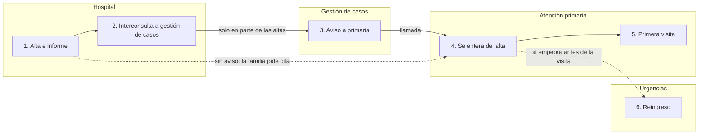

# Ejemplo — Mapa del proceso (VSM simplificado) del alta por IC

> Caso ficticio: continuidad tras el alta en IC, Área de Salud del Valle. Modo A (desde la síntesis de entrevistas).

# Mapa del proceso actual — Continuidad tras el alta en IC

**Estado:** BORRADOR · **Tipo:** VSM simplificado (el problema es de demoras tras el alta)
**Empieza en:** decisión de alta en planta · **Termina en:** primera visita en primaria o reingreso · **Paciente tipo:** mayor de 75 años con IC, alta desde Medicina Interna

## Pasos
| # | Paso | Quién | Nivel | Información (cómo) | Tiempo de proceso | Espera hasta el siguiente | ¿Medido o estimado? | Problemas | Fuente |
|---|---|---|---|---|---|---|---|---|---|
| 1 | Dar el alta y entregar el informe | Médico y enfermera de Interna | Hospital | Informe en la historia compartida | 30 min | 0–3 días | Estimado | Cambios de medicación poco explicados | Entrevistas |
| 2 | Solicitar interconsulta a gestión de casos | Interna | Hospital | Interconsulta electrónica | 5 min | 1–3 días | Estimado | No en todas las altas; casi nunca en fin de semana | Entrevistas (contradicción) |
| 3 | Avisar a primaria | Gestora de casos | Transversal | Llamada | 10 min | — | Estimado | Solo en los casos que recibe | Entrevista |
| 4 | Enterarse del alta | Primaria | Primaria | Ninguna, si no hay paso 3 | — | 7–14 días | Estimado | Sin aviso automático; se enteran por la familia | Entrevistas |
| 5 | Primera visita tras el alta | Médica / enfermera de familia | Primaria | — | 20 min | — | Estimado | Agenda a 9 días | Entrevista |
| 6 | Si empeora: acudir a urgencias | Paciente / familia | Urgencias | — | — | — | — | Urgencias no ve si está en seguimiento | Entrevista |

## Diagrama

## Métricas (estimadas, a medir)
| Métrica | Valor | ¿Medido o estimado? |
|---|---|---|
| Tiempo del alta a la primera visita | 8–17 días | Estimado |
| Tiempo de atención en ese tramo | ~65 min | Estimado |
| % de tiempo que aporta valor | <1 % | Estimado |
| Espera más larga | Paso 4: enterarse del alta (7–14 días) | Estimado |

## Huecos y datos a recoger
- Qué pasa con las altas de **Cardiología** (nadie lo ha descrito).
- **Medir** durante 4 semanas: días entre el alta y la primera visita, y si hubo interconsulta a gestión de casos (hoja de recogida).
