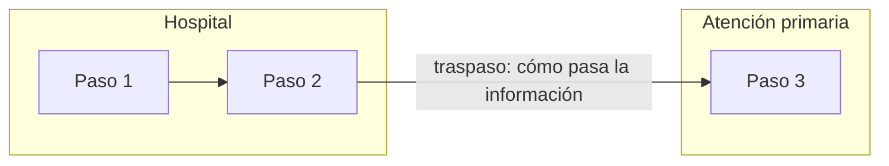

# Mapa del proceso actual — [proyecto]

**Estado:** BORRADOR / validado por el grupo el … · **Tipo:** mapa por carriles / VSM
**Empieza en:** · **Termina en:** · **Paciente tipo:**

## Pasos
| # | Paso (verbo + objeto) | Quién | Nivel / carril | Información que pasa (cómo) | Tiempo de proceso | Espera hasta el siguiente paso | ¿Medido o estimado? | Problemas | Fuente |
|---|---|---|---|---|---|---|---|---|---|
| 1 | | | | | | | | | |

## Diagrama

## Métricas (si es VSM)
| Métrica | Valor | ¿Medido o estimado? |
|---|---|---|
| Tiempo total del recorrido | | |
| Tiempo de proceso total | | |
| % de tiempo que aporta valor | | |
| Espera más larga (dónde) | | |

## Problemas localizados
| Paso / traspaso | Problema | Origen (entrevista, sesión, dato) |
|---|---|---|

## Huecos y datos a recoger
-
